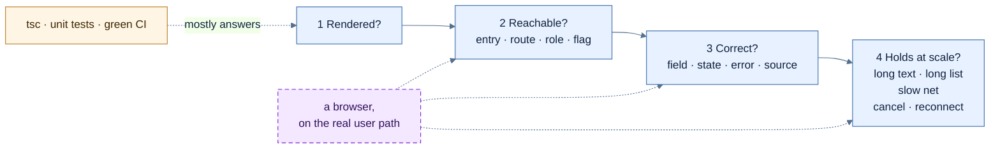
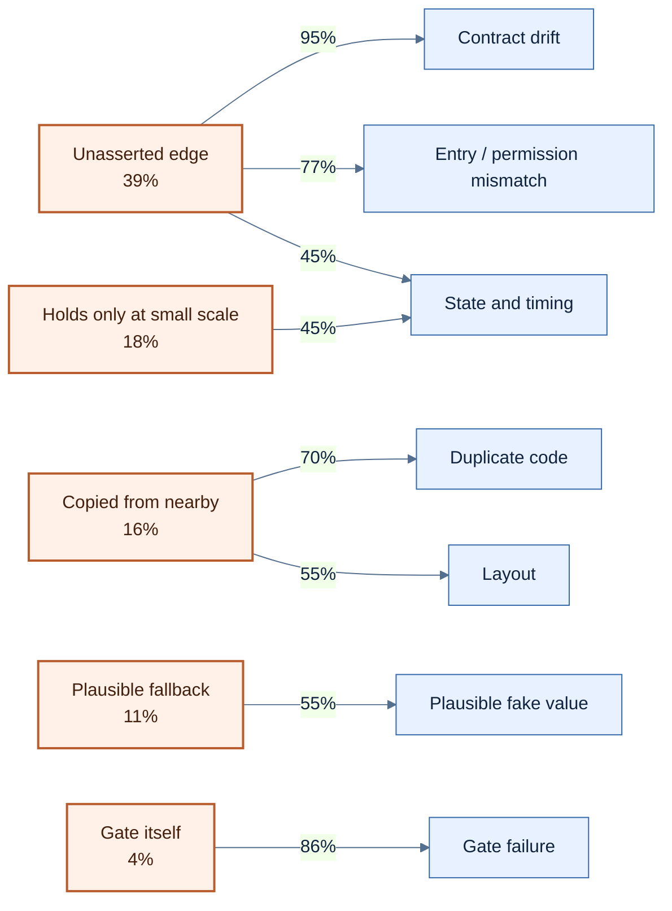
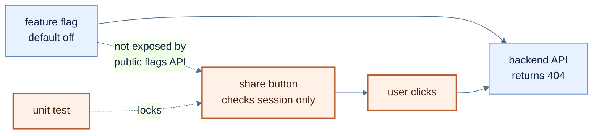
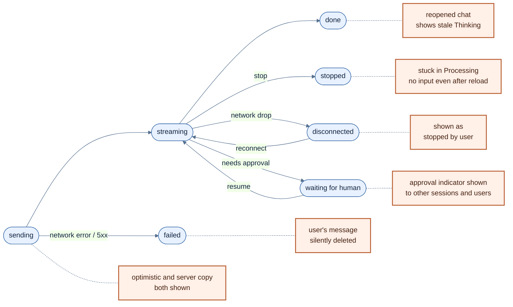
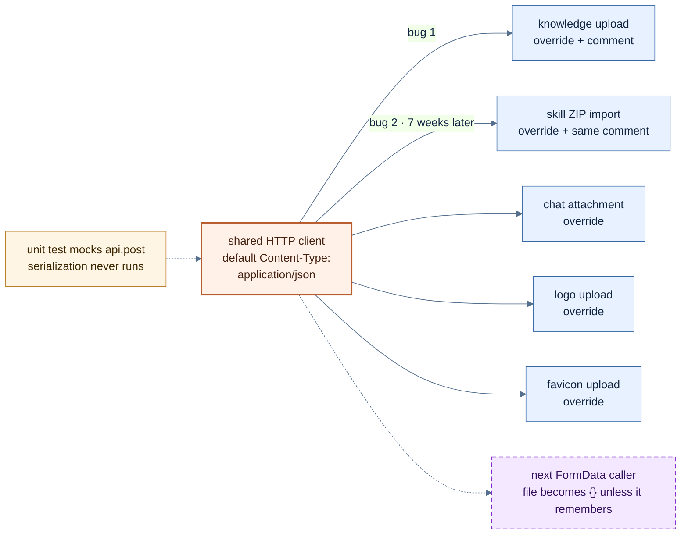
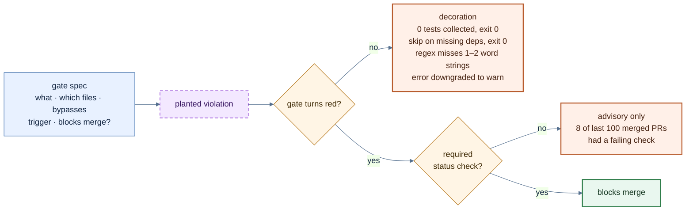

> A backend failure gives you a 500. A frontend failure usually gives you a page that looks fine.

> *Co-created with AI.*

# 0x00 Preface

In [AI Coding Best Practices](https://iami.xyz/ai-coding-best-practice-with-cursor/) and [The Vibe Coding Survival Guide](https://iami.xyz/vibe-coding-complete-guide/) I touched on bug taxonomies, but never went into detail on the product UI side. This post fills that gap. Vibe coding a backend and vibe coding a frontend turn out to be very different experiences. Part of that may be me: modern frontend frameworks were never my strong suit.

Every example below comes from an internal project. The frontend is now roughly 100,000 lines excluding tests, written by a few people plus a pile of agents (Claude Code, Codex, and Cursor all took part). There are 800-plus frontend-related commits, and more than 380 of them start with `fix`. That is more than `feat`.

For this post I had an agent go through every frontend fix/test/refactor commit, every frontend-related issue, and every frontend item from our audits, classifying each one. For the key cases I went back to the commits and the code myself. After deduplication, that left 454 distinct issues.

Each issue is classified on two axes: what it looked like, and, from a vibe-coding perspective, why it happened.

> ⚠️ Caveats
> - Selection was by title prefix and keyword. Bugs fixed in passing inside a `feat` commit, and issues whose titles never mention the frontend, are missed. 454 is a floor.
> - Many fix commits are a one-line title. For roughly 30% of issues the cause could not be determined, and for about half, neither could how it was found. All percentages below use "determinable" as the denominator.
> - Causes were judged from commit and issue text, not by reproducing each one. Individual calls may be wrong. What matters is the distribution.

Frontend bugs have one defining trait: **they rarely throw.** When the backend is wrong you usually get a 500, a stack trace, or a non-zero exit code. **When the frontend is wrong, the most common outcome is that it draws something plausible.**

So frontend acceptance now starts with four quick questions:

1. Did it render?
2. Can the user reach it? (entry point, route, permission, flag)
3. Is what it shows correct? (field, state, error, source)
4. Does it hold up at scale? (long messages, long lists, slow network, cancel, reconnect)

TypeScript passing, unit tests green, and CI green mostly answer the first question. The other three are not something a coding agent can settle from a terminal.



*Figure 1: Four questions for accepting frontend work. Type checks, unit tests, and CI mostly answer the first. The other three need a browser, walked along the user's actual path.*

# 0x01 The Numbers First: Where Do the Problems Come From?

> Of the issues with a determinable cause, 84% fall into four buckets.

By symptom:


| Symptom | Count | Share |
| --- | --- | --- |
| State and timing: sessions bleeding into each other, stuck in "processing", duplicated messages | 94 | 21% |
| Plausible fake values: failure drawn as 0, fake status, silent truncation | 75 | 17% |
| Layout and visuals | 61 | 13% |
| Entry and permission mismatch: flag off but button lit, menu hidden but URL still works | 44 | 10% |
| Frontend/backend contract drift: field names, response shape, missing fields | 43 | 9% |
| Duplicate and dead code | 28 | 6% |
| Scale and performance | 23 | 5% |
| Shared request layer | 18 | 4% |
| Internationalization | 15 | 3% |
| Gates and tests themselves broken | 14 | 3% |
| Accessibility | 7 | 2% |
| Other (including dependency vulnerabilities) | 32 | 7% |


By cause (321 determinable):


| Cause | Count | Share |
| --- | --- | --- |
| Both sides correct on their own; nobody asserted the edge between them | 126 | 39% |
| Holds only in a short demo, with small data, in a single session | 58 | 18% |
| Copied from nearby, without inheriting the shared structure | 50 | 16% |
| A plausible fallback instead of admitting "I don't know" | 34 | 11% |
| Gate not run, bypassable, or itself falsely green | 14 | 4% |
| Rule written but not followed, or followed mechanically | 13 | 4% |
| Deployment environment, browser, or third-party differences | 13 | 4% |
| Requirements kept changing | 9 | 3% |
| Test blind spots | 4 | 1% |


The top four add up to 84%. They share one trait: **look at the offending code in isolation and you usually cannot fault it. The problem lives between pieces of code, or between the demo and real use.**

Symptoms and causes mostly come in pairs:

- Among fake values, 55% are "plausible fallback".
- Among entry mismatches 77%, and among contract drift 95%, are "unasserted edge".
- Among duplicate code 70%, and among layout issues 55%, are "copied from nearby".
- Among gate failures, 86% are the gate's own fault.
- State issues are the odd one out: "unasserted edge" and "holds only at small scale" account for 29 each.




*Figure 2: Causes and symptoms come in pairs. On the left, each cause's share of all determinable issues. The number on each edge is that cause's share within the symptom on the right, using the symptom's determinable issues as the denominator.*

How they were found (216 determinable):

- Someone hit it while actually using the product: 35%
- Audits: 31%
- PR review: 15%
- Issue reports (channel unknown): 11%
- CI and tests: 7%

Of the 16 found by CI, at least 10 came from a QA agent's browser sweeps in the integration environment, not from unit tests. Frontend defects caught by unit tests, type checks, or lint on their own: **single digits.**

How a problem surfaces says a lot about how well it hides:

**Layout problems are the easiest for a human eye to catch; they get found quickly in review or daily use. Fake values, state and timing, and contract drift do not crash and do not turn anything red. Neither tests nor eyes catch them on their own. Most of them sat undetected until a deep multi-round audit or an end-to-end sweep of an extreme path dug them out one at a time. Fake values and gates do not announce themselves.**


# 0x02 Values That Look Right

> A blank page at least raises suspicion. A plausible fake value does not.

If a page goes white, everyone knows it is a bug. If it draws a value that looks reasonable, nobody questions it. This category shows up 75 times in our fix history, and on closer inspection it comes in three flavors.

**First: a failure drawn as a value.**

- Three dashboard widgets used `?? 0` when their query failed, so the page said "0 memories". Users could not tell whether there really were none or the read had failed. The same batch had four copy buttons that reported "Copied" even after the browser denied clipboard permission. I fixed this batch together with Claude. Nine days later, seven other dashboard widgets had exactly the same problem, and admins saw every metric as 0. A colleague fixed that one. There are still 92 occurrences of `?? 0` in the frontend source today. Not all of them are bugs. Nobody has gone through them one by one.
- The agent editor has a tool picker that groups tools whose MCP server has been disabled. While the server list was still loading, an empty array `[]` was taken as evidence that the server was disabled, so every healthy tool was flagged as orphaned. A colleague and Cursor fixed it four times in two days: first for "list not loaded yet", then for refetches reporting success mid-flight, then for `paused` also counting as not-loaded, then another guard in the grouping logic itself. Each fix removed one state and the next state popped up.
- The model selector was blank. Expanding it showed one hardcoded entry, "Gemini Flash (Fallback)". The backend logs showed 64 requests to the model list endpoint, all 200, none failing. A user seeing this would assume they had no models configured, or that the system had silently fallen back to Gemini.
- A detail page fell back to a static fixture when its endpoint returned 404, displaying "Approved" and "Verified". A scan result card whose report had been withheld for permission reasons showed "No verified findings", which users read as "there is no report".

**Second: demo material that never got taken down.**

- The License page in Settings showed a hardcoded sample organization name and plan. The backend had no such endpoint. The ticket was marked done.
- A page close to 3,000 lines, mostly fixtures, ran a fake animation on `setInterval`. An agent-run follow-up audit turned it up. It was later changed to say plainly that real data was unavailable, instead of showing simulated data.
- The most absurd one was mine. Early on, prototyping gesture interaction with Cursor, the HUD printed "Calibrating sensors", "Hand detected", "Gesture recognized: swipe left" in sequence. The cursor position was a random number. The camera was never requested. It sat on the main branch for three months. The commit that finally removed it carried a line I fully agree with: **fake perception and fake findings are the same class of defect. For a security product, that is worse than any performance problem.**
- There was also a debugging `window.onerror` handler that replaced the entire page with a red "Application Error" screen plus stack trace on any uncaught error. On a customer's first deployment, a harmless font-loading race tripped it. That handler had been in my earliest commits. Cursor and I deleted it later.

**Third: failures swallowed or cut off.**

- An early audit listed a dozen API calls that logged a single `console.error` on failure and showed nothing in the UI. Users assumed the operation had succeeded. Deleting an agent, for example: **on failure, the confirmation dialog closed unconditionally, so the user believed the delete had gone through.**
- The worst one sat on the core send path. If sending a message hit a network blip or a 5xx, the message the user had just typed was removed from the UI, with one line left in the console.
- The chat card rendered only the first 4,000 characters of a report, so a slightly long pentest report was cut off in the middle with no way to see the rest. The evidence component truncated any field over 180 characters to an ellipsis, with no expand and no copy-full-text affordance. In a security audit, a JWT signature chopped in half or a PoC with only its first half is not "ugly typography". It steers the analyst into reading a vulnerability as benign. A colleague later changed it to load the full text on demand, and to fail loudly when that load fails instead of quietly falling back to the truncated version.

There is a subtler variant: two fields answering the same question. The message object carries both `agentId` and `sender`, both answering "who said this". Nothing requires them to agree, so several pages each wrote their own fallback:

```text
// conversation page
senderKind = sender?.kind ?? (agentId ? 'agent' : 'user')

// share page
senderKind = sender?.kind ?? 'agent'
```

**The day a message arrives with neither field, the conversation page will say the user said it, the share page will say the AI said it, and neither will throw.** Nothing has gone wrong yet only because the backend happens to always populate `sender`. The first two came from the same colleague, a month apart. The third was written by someone else, in the same shape as the conversation page. Each line is correct on its own. No piece of code is responsible for "these two fields must point at the same person".

More than half of this category is "plausible fallback". The agent is asked to make the page run, look good, and not throw. The cheapest way to satisfy that is a presentable default. Starting from "don't let the page crash", `?? 0` is a very natural answer.

What works against this:

- When a read fails, show "unknown" or an error state. Do not supply a default. In review, when you see `?? 0`, `|| []`, `?? 'agent'`, or a `catch` that only has `console.error`, ask first: when the value is missing, does the user see a fact or an invention?
- "Still loading", "failed to load", and "actually empty" are three states. Do not represent them with one empty array.
- One display semantic gets one authoritative field. Pick it, migrate every display site, delete the other. A smarter fallback does not fix this.
- Truncation, filtering, and pagination must be visible to the user.
- Fixtures and mock data need an unmistakable marker, and a script that scans for them before release. Demo code does not remove itself.


# 0x03 Both Ends Are Right. What About the Middle?

> The button is lit. The backend has not agreed.

That is the second question: can the user actually reach it?

Code is often written piece by piece, each piece correct in isolation, and then the user follows the real path and it falls apart. The button is lit in the UI while the backend endpoint is switched off. Or the reverse: an entry that should be hidden from ordinary roles is only hidden in the menu, and typing the URL gets you straight in.

This is the single largest cause. The frontend did half, the backend did half, each passes its own tests, and together they are wrong. Entry mismatch and contract drift total 87 issues, and almost all of them fell here.

Take the share button that used to sit at the top right of the conversation page. It turned a conversation into a read-only public link that needed no login. The risk is obvious, so the backend put it behind a deployment-level flag, default off. With the flag off, the whole group of share endpoints returned 404.

On the frontend, the button's visibility depended on two things: a session exists, and the request is authorized. Neither has anything to do with whether sharing is on. Nowhere in the frontend was that flag ever read. Flag off, button lit, error on click.

The interesting part is that the frontend knew. The share dialog already had copy for the rejected case: "Sharing is not enabled. Contact your administrator." The default-off backend flag, the button that ignores it, and that message were all written in the same commit, with a `Co-Authored-By: Claude` trailer. The agent that wrote it could see both frontend and backend. It implemented the flag and the rejection. It just never connected the two ends.

Dig further and the gap is more complete: the public endpoint the frontend uses to read runtime flags does not return this flag at all. The component could not read it even if it tried. There is a unit test protecting the button, and what it asserts is precisely the condition that ignores the flag. **The test is not wrong. It locked a wrong judgment in as the regression baseline.**



*Figure 3: The flag, the backend, and the button are each correct. What is missing is the line from the flag to the button.*

Plenty more of the same kind:

- The sidebar hides menu items by role, but only cosmetically. A non-admin can type the URL and land on user management, system settings, and audit logs. The backend returns 403. The page shows nothing.
- The backend returns `createdBy`; the frontend reads `created_by`. Non-admins never see the edit and delete buttons on agents they created. Type checking passes because the frontend's type definition also says `created_by`.
- The backend shipped its delegation config endpoints. The frontend changed zero lines. Nothing calls them. A fresh deployment reports "list is empty" with no configuration entry anywhere.
- The reverse also happened: a capability card setting in the admin console that can be clicked and saved, but no runtime code reads it. This dead-switch pattern appeared twice.
- Three knowledge-base retrieval tools were hidden in every picker and had no seed data, so no agent could use them. It took two fixes on the same day.

Contract drift is even more direct:

- A QA agent running browser sweeps in the integration environment hit a page that called eight endpoints, all returning 200, and still crashed on `n.map is not a function`. One endpoint's response was not an array.
- A playbook node was missing its `position` field. React Flow crashed, and the entire playbook page became unusable for every user. One bad record took down a whole page.
- The backend sent a heartbeat frame without an id every 15 idle seconds. The frontend parser threw on any frame without an id, so the connection reconnected roughly every 16 seconds and the cursor never moved.
- The team settings page initialized its form from a member list that had been truncated by a runtime cap. Twelve members in the database, a cap of four in that environment, four in the form. One click on Save and the other eight were permanently deleted. This is the textbook case that got caught in PR review.

What works against this:

- "What does the feature look like when it is off" must be a rule that both frontend and backend follow, with one test that covers all three layers: the entry is invisible, the direct URL is blocked, and the backend still refuses. Test only one layer and the agent gets a "done" that is true locally.
- Frontend test data should use real response shapes, ideally generated from the backend schema. Hand-written mocks follow the frontend's imagination.
- Every time the backend ships a user-facing endpoint, ask: where does the frontend call it? Every time the admin console gains a switch, ask: where does the runtime read it?
- One bad record may break one node or one card. Not a whole page.

```ts
// Example: replace seed and assertions with the project's real implementation
test('disabled feature is not reachable', async ({ page, request }) => {
  await seedFlags({ dangerousFeature: false })
  await page.goto('/home')
  await expect(page.getByRole('button', { name: /share/i })).toHaveCount(0)

  await page.goto('/dangerous-feature')
  await expect(page.getByTestId('feature-unavailable')).toBeVisible()

  const res = await request.get('/api/dangerous-feature')
  expect([403, 404]).toContain(res.status())
})
```


# 0x04 State: Correct in a Single Session With the Network Up

> Switch sessions, refresh the page, drop the network, and the problems come out.

This category is maddening. Read the code statically and you cannot fault it. Run it for real, let time pass, let branches multiply, add a little network jitter, and state falls apart.

State and timing is the largest category: 94 issues. In AI Coding Best Practices I mentioned one: click another conversation and every conversation shows "waiting". In this project that bug kept coming back in new costumes:

- After logout, session expiry, or identity switch, the shared query cache was not cleared, so the previous identity's data could remain on screen.
- The optimistically inserted message and the server's official message were both displayed. The same sentence appeared twice.
- A client-side disconnect was displayed as "generation stopped by user", contradicting the terminal state the backend persisted.
- Mutations auto-retried, which could replay a non-idempotent POST.
- A component's comment said "parent remounts via key". The parent passed no key, so stale state lingered. "The comment says it's implemented, the code doesn't" appeared twice.

The canonical case is the "running" indicator on the session list. A colleague opened five fix PRs in six days. First the spinner style changed. Then the indicator turned out not to be bound to whoever started the run, so other sessions and other users saw it too. Then the HITL waiting-for-approval indicator had the same problem. Then the status polling was split apart. Then the initialization merge was found to overwrite an already-finished indicator, because an explicit `null` and a missing field were treated the same. After five PRs there was still one more: "reopening a completed session shows stale Thinking". Every one was a real bug. Every fix addressed only the state in front of it.

Then there is the stubborn kind:

- After pressing Stop, the session stayed in "processing" and a full page reload did not bring the input back.
- Messages lived in two places, the query cache and a per-session Map, kept consistent by six or more ref patches. The hook responsible for it swelled past 3,000 lines at one point.

The causes here split evenly between "unasserted edge" and "holds only at small scale". When an agent writes state logic, it usually has a straight line in mind: send, wait, display. Switching sessions, dropping the network, stopping, reconnecting, changing identity, two tabs: every one of those is a branch off that line, and a single-session demo never walks any of them.



*Figure 4: Every branch off the "send, wait for reply" straight line has had a bug.*

What works against this:

- One piece of data has one source. If messages live in both the cache and a Map, they will disagree eventually.
- Draw the state transitions: sending, streaming, stopped, failed, disconnected, waiting for human, resumed, reconnected. Where each state can go, and what each terminal state shows in the UI. Then write tests from that diagram, not from the straight line.
- Stop, cancel, resume, and reconnect need a full round trip in a browser. Checking values in the state object is not enough.
- If the same component gets fixed more than three times in a week, stop. Have someone else re-examine it from the state model. Do not ship fix number four.


# 0x05 Fixing at the Call Site Every Time (Copied From Nearby)

> AI likes to copy from nearby. The comment propagates; the fix never sinks.

"Copied from nearby" is 16% of determinable causes. When an agent writes new code, it takes the nearest similar piece as its reference. The appearance matches; the structure is not inherited. Bug fixes work the same way: fix the call site in view, leave the shared layer alone, and the next feature hits it again somewhere else.

**The shared request layer.** The shared HTTP client hardcoded `Content-Type: application/json` at creation. Under that content type, axios serializes `FormData` to JSON, so an uploaded file arrives as `{}`. TypeScript says nothing. The types are all correct. The file is gone.

The first hit was knowledge-base upload. A colleague and Claude fixed it by overriding the header at the call site, with a comment beside it that explained the shared client's problem clearly. That commit also recorded something worth remembering: the earlier unit test had mocked `api.post`, which bypassed axios serialization exactly, so the test had always been green. (The layer that was mocked out was precisely the layer with the bug.)

Seven weeks later, skill package import uploaded a ZIP through the same client, and the backend received `{"file":{}}`. This time a colleague and Cursor fixed it, again by adding the header at the call site. The first three lines of the comment next to it are identical to the first one, word for word. That comment diagnoses the shared layer accurately and has been copied along faithfully. The one line of default in the shared layer has still not changed. Five call sites now route around it.



*Figure 5: One default in a shared layer, five call sites routing around it. The comment travels with each copy, the default never changes, and the next upload feature has to remember on its own.*

Same layer, more cases:

- The workspace ID selected in the admin console was attached as a default request header and leaked into ordinary business requests, which then returned 404. Happened three times, each fixed in one place.
- The backend's collection routes had trailing slashes; the frontend requests did not. FastAPI returned a 307 to the backend's origin, the browser dropped the `Authorization` header on the cross-origin redirect, the endpoint returned 401, and the session-expiry handler kicked the user to the login page. The symptom: "open the API Key page and get logged out".
- A settings page used native `fetch` with a hand-written Bearer header, bypassing the shared client's interceptors. No token refresh, no unified error handling.
- A 403 error object was rendered as a React child, triggering React error #31 and dropping the whole page into the error boundary. Fixed once; another page did it again later.

**The copies.**

- A helper that normalizes filter conditions was copied into 14 modules. One variant dropped empty strings, so clearing the search box added an extra key to the cache, depending on which version a module had copied. Two error-handling modules were byte-identical; the tests imported the one nobody used, while the one referenced from eight places had no coverage. Claude and I cleaned that up.
- Agent avatars were rendered in eight places, each its own way, and the default avatar image file did not exist.
- Eight components each maintained their own Snackbar. Notifications could not stack and disappeared on different schedules.
- Nineteen panels each hand-wrote their "nothing selected" placeholder, in two different styles. Fifteen of them matched exactly the sample the layout guide had written down as an example. The guide turned a copy into the standard.
- An old aggregation fix only applied on the old render path. When the UI moved to a new timeline component, the same problem came back.
- It is not just big pages. Side panels and drawers are the worst. When a 300-pixel sidebar cannot fit a complex configuration, the agent's reflex is to copy the standard Tabs component from the page header, large icons and wide padding included. Three tabs in, the viewport bursts and a scrollbar with arrows on both ends appears. Or it stacks the tool list, the skill list, and the workflow config vertically in the side panel, notices it is too long, and slaps `maxHeight: 200; overflowY: 'auto'` on every list. Each block holds up on its own. TypeScript does not complain. The user hovers, turns the wheel, and falls into a local scroll trap. The agent thinks it delivered a graceful fallback. It built three layers of nested, Russian-doll miniature scrollbars inside a side panel.

**Rules in docs: the agent reads them and forgets them.**

The admin console has a family of "list on the left, detail on the right" pages with a shared skeleton. Some pages used it. Some hand-assembled a structure that looked almost the same. The session log still contains the plan the agent wrote when generating one of those panels:

> Give the skeleton (imports/state/effects/handlers) in full inside the plan. For the large JSX, instruct "copy [the 200-line JSX block from the existing admin page] verbatim" (identifiers unchanged, **more deterministic than me retyping it**).

**It knew the shared structure existed. It was not being lazy. It judged that copying a working block was less error-prone than rewriting it.** For that one instance, fair enough. But each copy is another replica that will not change when the shared layer does, and no check will reject it for copying too well.

After the consistency cleanup, Claude and I wrote the layout rules into the frontend guide. One of them: admin panels get no manual refresh button and no stats copy; refreshing is left to the query cache's automatic invalidation and refetch. A few days later a Codex session did an information-architecture refactor across nearly a hundred files, and the next day added a refresh button back onto a task list.

**Going through the session log, it had read that guide, more than once. But over the next ten hours the session compacted its context five times, and none of the summaries carried that rule.** After compaction, what it re-read was the repository README, which only says "must use the shared skeleton". Then it noticed that idle lists do not poll, so tasks created externally never appear, and proposed a refresh button. I approved it. Its diagnosis was right: the change that removed the button, committed by me alongside the guide, removed only the button and added no other refresh mechanism. The agent found a real bug and used the fix the rule forbids. The person who approved it had helped write the rule.

The button was removed again, this time with idle polling added. But to comply with "no stats copy", the hint next to it, "filters apply to the most recent 100 only", was removed too. Without it, records beyond 100 silently fail to match. A day later that hint was added back on its own. A rule followed mechanically can delete a true piece of meaning on the way.

Our handful of custom lint rules catch forbidden patterns (native dialogs, hardcoded colors, cross-module imports, and so on), but they cannot answer the positive question: does every component registered as an admin page use the shared skeleton? There is a positive assertion in the code that requires a given file to import the skeleton, but it is registered file by file. The skeleton now has thirty-plus consumers. Six are covered.

What works against this:

- When the same root cause appears a second time, fix the shared layer, not the call site. Here that means letting the client choose Content-Type from the body type, with no default for `FormData`.
- For special transport paths like uploads, do not mock the request library in tests. At least one test must run the real serialization.
- In review, a comment that "explains a defect in the shared layer" is an open bug. Treat it as one.
- The second copy is when it goes back into the shared layer. Do not wait for the fourteenth. Tests must test the copy that is actually referenced.
- Let scaffolding, shared hooks, and finer-grained components carry the right structure into new pages. Hang assertions on the page registry, not on a per-file list. A rule that gets compacted away is worth less than a default that cannot be deleted.
- Rules that truly matter cannot live only in "the guide we link to". Either put them in the file that gets re-read every time, or make them lint.

Going through all these copying records, the thing that struck me most: when we built component libraries and wrote layout guidelines, the assumed user was a human engineer who would read the docs, understand the context, and adapt on the spot. **When AI writes the code, a rule in a document barely survives a few rounds of conversation.**

You cannot expect an agent, after five context compactions, to remember "don't use standard Tabs in a narrow side panel" or "don't nest `overflow: auto` lists inside small containers". Reminding the agent through documentation does not work. What works is building the rule into the component's structure: a side-panel segmented control hard-wired to 32 pixels tall, equal-width and responsive, physically incapable of horizontal scrolling; a list container whose loading and error states are required props, so leaving one out fails type checking.

We later did a site-wide convergence to carry that principle through:

- **Every detail page converges on a fixed header and a single scroll.** In the two-column layout, detail subcomponents no longer decide whether to scroll. The skeleton provides `DetailHeader` (object title, actions, and status chip, locked in place) and `DetailBody` (the one and only vertical scroll flow). Across twenty-plus admin modules, subcomponents lost the right to add their own outer scroll. Nested-scrollbar debt went to zero.
- **Container queries decouple nested squeezing.** Two-column admin pages stopped relying on global viewport media queries, which sidebars blow up easily, and switched to `@container` queries. Once the body container drops below 760px, however many sidebars are open outside, it collapses to a single column, keeps the body readable, and demotes the auxiliary panel to a Drawer.
- **A single-row scrolling control, enforced.** One shared single-row scrolling `AppTabs` (48px/40px), and a gate that forbids importing MUI's native Tabs directly anywhere on the site.

**The most effective constraint on an agent is not "do not write this" in a guide. It is making the wrong form inexpressible in the code structure.**

# 0x06 What Happens at Scale?

> A performance problem nobody tested does not stop existing because nobody tested it.

When the data volume comes up, does the UI hold?

Finish the demo, test locally with two or three records, and it is buttery smooth. In the real environment, hit a few thousand characters of text, a list of hundreds or thousands of rows, or an extreme viewport, and the system degrades either spectacularly or in total silence.

Scale and performance on its own is only 23 issues, but "holds only at small scale" is 18% as a cause, and half of that lands in state issues. Here are the ones directly about volume.

The chat streaming path has a typical structure: the backend emits one event per token, the frontend appends the chunk to an accumulated string, then writes the whole text back to the message object. Content changed, so the Markdown component re-parses the whole text, including syntax highlighting and link plugins. The longer the answer and the more chunks, the closer the cumulative work gets to quadratic.

```text
bad:    chunk -> parse(all_text) -> render(all_text)   # full pass on every chunk

better: frozen_prefix = parse(complete_blocks)   # update only at safe block boundaries
        live_tail     = render(raw_tail)         # process only the current tail
```

The inside of that Markdown component is telling: media credentials wrapped in `useMemo`, the `components` map wrapped in `useMemo`, and `content` passed raw, with the plugin array rebuilt on every render. The optimizations were applied around the edges. The hottest path was untouched.

An architecture audit rated it P1. I filed the issue myself. It is still open. The backend later switched to non-streaming, so the per-token input disappeared and this path lost its trigger for now. The frontend structure has not changed by a single line. It is not fixed. It is temporarily without input. The day streaming comes back, the recomputation comes back with it.

A few more:

- An operations page aggregated a dozen data types into one initialization endpoint, about 2.8MB per response. The session list, which the sidebar needs only titles from, came with full tool-call records. When a session was waiting for human approval, the frontend used that endpoint as its status poll, about 12 calls per 10 seconds, background tabs included.
- The animated background generated particles by viewport area with no cap. On a 4K screen: 691 particles, about 238,000 neighbor checks per frame.
- Chat history fetched 100 sessions at a time and silently truncated the rest. Search filtered only what was loaded.
- Audit log search by operator fired a server query on every keystroke.
- Asking the agent to chart alert types over the last 7 days in chat: a dozen categories, long Chinese labels, values from single digits to seventy thousand plus. Axes clipped and overlapped, basically unreadable. That is exactly the most common report shape in security operations.
- The model emitted a five-column security asset audit table in Markdown. The Markdown component did basic layout only, with no horizontally scrolling isolation container around it. The wide table pushed the chat window and its parent flex container out sideways, and the fixed action area on the right went off screen. Long text on the frontend usually dies at one of two extremes: brutally truncated and losing data, or dropped raw into the DOM and breaking the layout.
- The virtualized list did not set `computeItemKey`, so rows were identified by position. The list filters out empty agent messages. When a message goes from empty to non-empty during streaming, every row after it shifts position, remounts entirely, loses local state like expanded/collapsed, and has to be re-measured. Still open.

What works against this:

- Split on Markdown block boundaries. Parse the settled prefix once and recompute only the live tail. Batch high-frequency updates per animation frame.
- Key virtualized lists by stable message ID, not position.
- Polling should respect page visibility, back off, and ask: does this endpoint need the full payload every time?
- Any "first N" must be shown to the user or turned into pagination.
- Prepare a "big" test dataset: long messages, lists of thousands of rows, charts with a dozen categories, a 4K screen, a slow network. Replay with it and look at long tasks and dropped frames in the browser trace. Asserting that the final text matches catches none of this.


# 0x07 Gates Leak Too

> A red test is not enough. When it goes red, it also has to block.

Gates and tests themselves broken: 14 issues, 6 unresolved, the highest ratio of any category. As noted, tests found fewer than one in ten frontend defects on their own. Going through them, some gates did not just miss problems. They were the problem:

- The performance test entry pointed at a file outside the test directory. The command collected 0 tests and returned success. The cases inside hit a route that had long since been renamed. A colleague later changed it to "fail if nothing is collected", but whether performance meets the bar has still never been proven.
- The lint rule for untranslated strings used a regex to decide "is this an English sentence", requiring at least three words. `Delete`, `Save`, `Cancel`, `Model Tier`, every one- or two-word string, slipped through. About 150 of them. The gate is green and a Chinese-locale deployment shows them in English. Still open.
- The local frontend check script printed one line, `skip`, when a dependency was missing, and exited successfully. The ticket title said it outright: "eliminate vibe coding false green". Also still open.
- One test asserted an English literal in a form, which locked "not translated" in as the regression baseline. When the translation was added, the test had to change with it.
- The bundle config pulled the chart library and the flow-diagram library into the initial load. The first screen actually loaded 468.6KiB, while the size check measured only the entry JS. There are now per-route budgets, but every time one is exceeded, it gets nudged up inside a feature PR. One route has 1.8% headroom left.
- I once misjudged frontend lint as "debt cleared". Going back to the diff, a dozen-plus rules had been downgraded from `error` to `warn`. A baseline monotonicity check was added afterwards, so suppression entries can only decrease. But warnings have no ceiling in the pipeline, and inline `eslint-disable` comments are not in the baseline file. There are 16 of them in non-test code.
- Red gates did not block merges. The repository's merge rules required one review and forbade force-push, but no check was marked required. Of the last 100 merged PRs, 8 went in with a failing check. (The failures were all backend unit tests, but the rule applies equally to the frontend.) That is my own repository configuration. Embarrassing to say out loud.




*Figure 6: A gate must first prove it turns red, then prove that red blocks. Everything in the orange boxes actually happened in this project.*

Audits need verification too. One frontend audit reported 18 "click-only, no keyboard" elements and 42 icon buttons without accessible names. When Claude and I went to fix them, we checked each one. Of the 18, 7 were real. Of the 42 icon buttons, not one was a problem (they were all wrapped in Tooltip). That commit said: verified against the audit, not taken on faith. Accepting the over-reports wholesale would have added a pile of redundant tab stops, which is itself a regression. In contrast, the 55 unlabeled switches the QA agent found with axe in the integration environment were all real.

What works against this:

- When designing a gate, state up front what it governs, which files it looks at, what the bypasses are, which event triggers it, and whether red blocks the merge.
- Every gate gets a deliberately planted violation to confirm it actually turns red. 0 tests passing is not passing. Skip is not passing.
- Budgets change only in a dedicated PR with a stated reason. Suppressions cannot grow, severity cannot weaken, exceptions need an owner and an expiry date.
- Make checks required status checks.
- Audit results, human or agent, get verified before they get fixed.


# 0x08 Closing

A typical exchange from the agent session logs: the agent reports "all CI passing, 1,345 frontend tests". Less than thirteen minutes later, in the same session, I ask: "The PR is merged. Are you completely done?" The first item in its answer: the sidebar no longer collapses to icon-only on a single click. (As I write this post, that problem has come back again. The previous PR "optimized" it into a different behavior, and the current PR is waiting to restore the previous one. This may be exactly what makes vibe coding tiresome.)

"Are you done" appears dozens of times in some sessions. Of the issues where the discovery channel is known, more than a third were hit by a person using the product, and fewer than one in ten were found by tests. On this pipeline, the human is nearly the only one who actually opens a browser. The agent accepts in the terminal. The problem stays in the browser.

Pulling the attribution together:

1. **Unasserted edge** (39%): frontend and backend, flag and entry, field and display. Each correct, wrong together. Test the edge. Test one cross-layer journey, not one layer.
2. **Holds only at small scale** (18%): single session, short answers, network up, three or four demo records. Prepare "big" and "bad" data and run it in a browser.
3. **Copied from nearby** (16%): appearance matches, structure not inherited. Fixed at the call site, resurrects somewhere else. On the second occurrence, fix the shared layer and make the right structure the default.
4. **Plausible fallback** (11%): invent a presentable value when you don't know. Make "unknown" and "failed" visible.

Gate problems are a small share, but they decide whether the four above get stopped.

So before a frontend delivery, I press on these:

1. **Which layer did this prove?** That the code ran and rendered, or that the user can reach it, the data is fully correct, and it holds at scale?
2. **Where was acceptance done?** Green unit tests in a terminal, or a full walk along the real path in a browser?
3. **What happens when the feature is off?** Do the UI entry, route guard, backend check, and config endpoint all tell the same story? Any "button lit, click gives 404", or "dependency still loading, judged as disabled"?
4. **What shows when a read fails?** An honest "unknown", or a fake value quietly invented by `?? 0` or `|| []`? Is long text over 180 characters expandable? Does each display semantic have exactly one authoritative field?
5. **Have the abnormal paths been run?** Session switch, network drop and reconnect, user cancel, bad data input: actually tested? Can one dirty record take down a whole page?
6. **Does the layout survive scale?** Thousands of characters of text, wide multi-column tables: is there horizontal-scroll isolation? Are there miniature scrollbars nested layer on layer in a narrow sidebar?
7. **How many times has this bug appeared?** If it is the second, was it fixed at the call site in view, or sunk into the shared layer?
8. **Can the gate actually stop someone?** Is the check a required status check? Has a counterexample been planted to confirm it does not print `skip` and return success when a dependency is missing?

Agents writing components is not the hard part. The hard part is how easily they look correct under local input and local tests. Write the lesson into docs and the agent forgets it in compaction. Write it into a gate and the gate leaks. Audits find problems, and finding them does not mean anyone fixes them. What you can do is keep the gates working, plant a counterexample every so often, and see whether they still go red.

Then open the browser and click through it yourself.

One last thing. Anyone who has read this far has surely felt the pain of vibe coding, and surely understands that the side effects of speed get amplified just as much. Why vibe coding is starting to wear people down has little to do with how complete your SDLC is or how clear your engineering is. This is vibe coding's native pain: building a demo and building a product are worlds apart.
