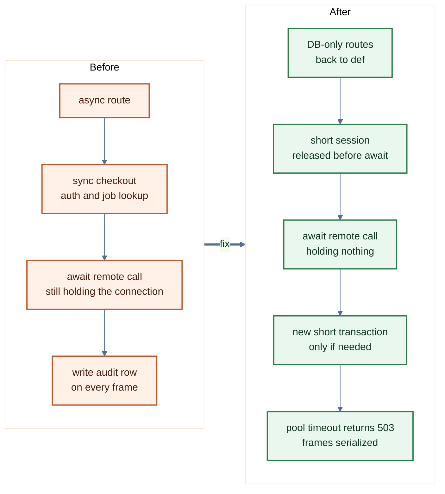
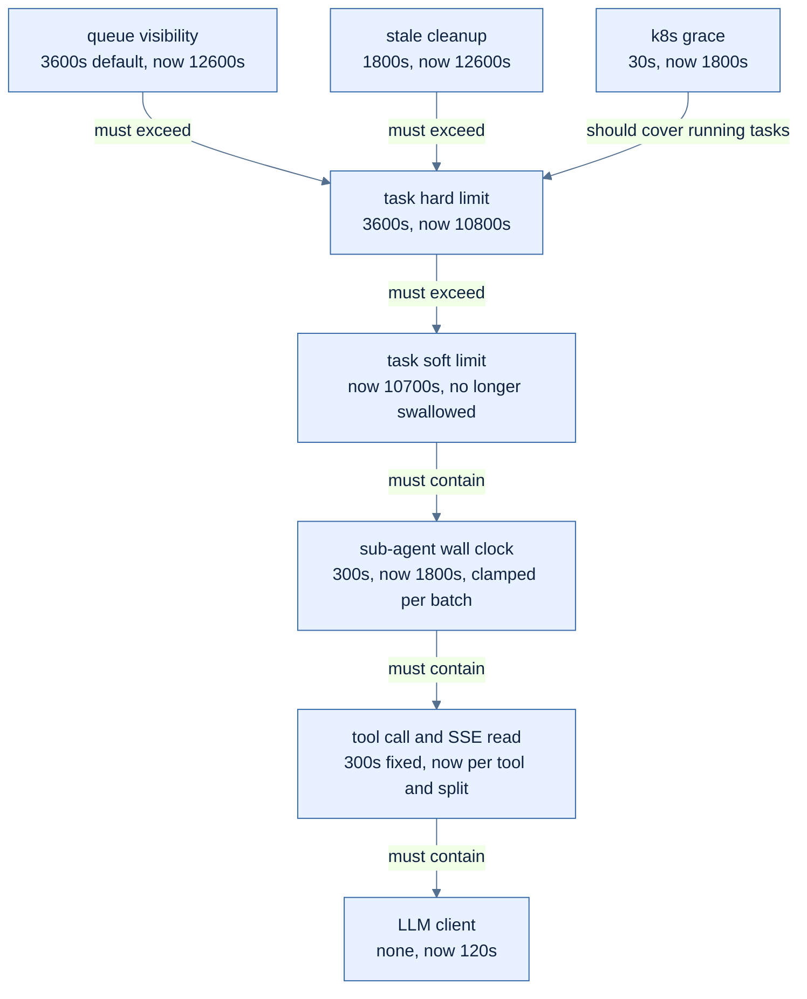
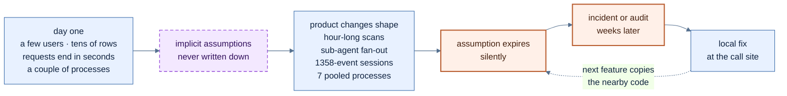

> When the frontend breaks, it draws a page that looks perfectly normal. When the backend slows down, it gives you a task that stays "running" forever.

> *Co-created with AI.*

# 0x00 Preface

In the preface to my last post, [Vibe Coding on the Frontend: A Near-Death Experience](https://iami.xyz/vibe-coding-issues-in-frontend/), I said one thing: vibe coding behaves very differently on the backend than on the frontend. This post covers the backend, and only one topic: **performance**.

The backend is Python: FastAPI plus SQLAlchemy, async tasks on Celery, running on k8s. Over ten-plus months it has grown to roughly 380,000 lines of code (excluding tests and database migrations). Like all our internal projects, it was written by a few people plus a pile of agents. Purely AI-native: every line of code was vibed out, but on top of an agent-based SDLC. For that side of the story, see my earlier posts:

* [SDLC in the AI Agent Era: Reapplying Security Engineering](https://iami.xyz/agentic-sdlc-bind-to-reality/)
* [Agentic Assurance Engineering: Bringing AI Coding into Real-World Engineering](https://iami.xyz/agentic-software-engineering-real-sdlc/)

For this post I had an agent go through the backend's commits, issues, and several rounds of implementation audits and pick out everything related to performance. For the key items I went back to the commits and the code myself. The first half covers one thing: **what performance optimizations we made**, grouped by category, each with what it looked like before, what we did, and what it looked like after. The second half asks one question: **why were there so many things to optimize, and why did nobody see them coming?**

> ⚠️ Caveats
> - The numbers come from three sources: local observations recorded in commit messages, read-only observations in the integration environment, and estimates derived from the code during audits.
> - Many numbers come from the integration environment. They are not proof of production capacity.
> - Only completed work is covered. Open issues are not discussed here.

# 0x01 Startup and Deployment

> The fastest optimization changed one line. The slowest was the one nobody noticed was slow.

**Startup: from 5 minutes to 8 seconds.** The container's start command was `uv run uvicorn`. Dependencies were installed when the image was built, but the project itself wasn't, so on every container start `uv run` redid the install: download pip, install the project, and only then start the service. On the dev environment we observed about 5 minutes of startup overhead, so the deployment script's health check was guaranteed to fail. The fix was to run uvicorn directly from the venv and add `exec`, making uvicorn PID 1, which also cleaned up signal handling. After the change, starting a container locally from the same image takes about 8 seconds.

A few other items:

| What we did | Before | After |
| --- | --- | --- |
| Worker liveness probe switched to a heartbeat file | A cold `celery inspect ping` took 9.44 seconds against a 10-second probe timeout, so workers got killed by mistake and their running tasks died with them | The probe just reads a heartbeat file |
| Worker rollouts scale up first, then allow time for graceful shutdown | With the k8s default of 30 seconds, every rollout SIGKILLed any execution that had been running for more than 30 seconds | New Pods come up first; old workers get 1800 seconds to finish what they're holding |
| Compression only for non-SSE responses | App-level GZip held back response headers until the first data chunk, delaying SSE by up to 15 seconds, so it was switched off entirely and multi-MB endpoints went uncompressed | A new middleware passes SSE through untouched and compresses everything else as usual |

Compression had the most winding history. At first gzip was on in both nginx and the application layer (and we spent a long time flipping it back and forth between nginx and the code). Then we found that app-level GZip was buffering streaming output, so we turned it off in the app, left nothing but a comment in the code, and handed compression to nginx. Later that same month we wrote a middleware that compresses only non-SSE responses. Non-SSE responses get the compression win, and streaming responses are left alone.

Common techniques for this category:

| Technique | How |
| --- | --- |
| Install dependencies and the project at build time | Multi-stage builds; copy the lock file and install dependencies first to get full use of layer caching; at runtime, no network and no installs, and the start command `exec`s the executable directly |
| The right PID 1 | Use `exec` so the service itself is PID 1, or add an init such as `tini` to forward signals and reap zombie processes |
| Three probes, three jobs | startupProbe covers slow starts; livenessProbe answers only "is the process still alive?", does not depend on external components like the database or Redis, and stays lightweight; readinessProbe decides whether to take traffic |
| Drain traffic before stopping the process | Sleep a few seconds in preStop until the Endpoint is removed from the Service; after SIGTERM the app stops accepting new requests, finishes in-flight work, then exits |
| The shutdown chain is only as long as its shortest link | `terminationGracePeriodSeconds ≥ preStop + longest task + margin`; task timeouts, the process manager, and the app's own graceful-shutdown timeout are all links in this chain, and the shortest one is the real window |
| Decouple long tasks from releases | Make tasks interruptible and resumable (checkpoints), or give long tasks their own worker group and their own release, so a rollout doesn't drag on for half an hour every time |
| Warm up at startup | Connection pools, clients, regexes to compile, config to load: finish them before ready, so the first request doesn't pay for them |
| Compress by response type | Don't compress streaming responses (SSE), or flush per chunk; pre-compress static assets (Brotli/gzip) and push as much as you can to the edge |

# 0x02 Database

> At 18,000 rows, a full table scan takes a few milliseconds. Nobody notices.

Database work made up the largest share of the optimizations, and it was also **the most "textbook": add indexes, remove N+1, paginate, merge queries.**

| What we did | Before | After |
| --- | --- | --- |
| Asset list: server-side pagination, search, composite indexes | The list returned everything, with no server-side search and no indexes | 20 per page by default, 200 max; fuzzy search on name and IP; composite indexes on tenant + type and tenant + status |
| Index on a foreign key | The team-visibility subquery filtered on `team_id`, but foreign keys don't get indexes automatically | Added the index |
| Index on the audit log | Only a primary key; it was sequentially scanned more than 35,000 times in the integration environment | Added a (tenant, time descending) index, also declared in the ORM model |
| Index on the case table | A scheduled task deduplicated row by row every minute, and the table got full-scanned more than twice per second | Added a (tenant, source reference) index |
| N+1 removed from the key-binding list | Each row queried lineage records twice on its own; one page sent 301 SQL statements | Authorize first, then one batched IN query per page, scoped by tenant |
| N+1 removed from the target list and scan-job list | Each row needed several separate queries; the scan-job list hit 301 in the worst case | Batched queries, plus a cap |
| Merged queries for session summaries | Message count and latest preview scanned the message table twice | One sorted window query, plus a regression test that "allows exactly one query" |
| Token stats for the dashboard | Every request read every message body and estimated in Python | Recorded at write time; the dashboard does a single SUM |
| Connection pool budgeted per process | Every process hard-coded 20 + 30; across all processes the theoretical ceiling was 350 connections, 650 during a rolling release, against a database limit of 100 | Allocated by process role, down on paper to 153 at steady state and 303 during rollouts; added a contract test that recomputes the total from the deployment manifests |
| Roll back bad connections first | When a long task's connection dropped, the exception handler wrote the failure record on the broken Session, the write failed, and the execution stayed `running` forever | Exception handlers roll back first; child processes no longer inherit the parent's database connections |
| Execution duration changed to a 64-bit integer | `duration_ms` was a 32-bit integer, good for about 24.86 days at most; one record that had run for 120-plus days made the cleanup task overflow every 10 minutes, failing 3,593 times in 30 days | Changed to bigint |

Two of these deserve a few more words. The asset list did three things at once: pagination, server-side search, and indexes. It was the most complete list optimization in this backend. In hindsight, **it should have become a template, but every other list endpoint still got fixed on its own...**

The session-summary change itself was tiny: two SELECTs merged into one. The regression test that came with it matters more. It asserts that the endpoint may send only one message query, so if anyone adds another query there later, the test goes red. **Indexes and N+1 fixes can be washed away by the next change. A query budget can't.** The connection pool item is the same. After the change, the on-paper number is still above the database's 100 connections, just smaller; actual peak usage today is only a dozen or so. The real change is that whenever someone adds a process or changes a pool size, the test recomputes the total.

**A fix isn't just changing the buggy code. It also means updating the matching tests, the docs and changelog, the vibe coding context.md and AGENTS.md, the issues, and so on. The agent era actually needs more discipline, not less, because this data and these rules are exactly what help agents do the development well.**

Common techniques for this category:

| Technique | How |
| --- | --- |
| Find the slow ones before adding indexes | Rank SQL by total time with `pg_stat_statements`; check which tables get the most sequential scans in `pg_stat_user_tables`; confirm the plan with `EXPLAIN (ANALYZE, BUFFERS)` |
| Indexes follow queries | Index foreign-key columns yourself (PostgreSQL won't do it for you); in composite indexes, equality columns go first and range and sort columns last; use a partial index when you only query a subset of rows, and an `INCLUDE` covering index when you only read a few columns |
| Block N+1 at the ORM layer | Preload relationships with `selectinload`/`joinedload`, or hand-write a batched `IN`; default relationships to `lazy="raise"` so implicit lazy loading fails loudly |
| Query budget tests | Use SQLAlchemy's `before_cursor_execute` event to count how many SQL statements a request sends, and go red when it exceeds the budget |
| Cursor pagination | Don't use large `OFFSET`s on big tables; do keyset pagination on (sort key, primary key) |
| Pre-aggregate at write time | Compute the stats a dashboard needs at write time, or use materialized views refreshed on a schedule; send heavy report queries to a read replica |
| A connection pool total, plus an external pooler | Σ(processes × (pool_size + max_overflow)) × rollout multiplier; a common rule of thumb is to keep it under 70% of `max_connections`, leaving a dozen or so for migrations and ops; once there are many processes, put PgBouncer in front (transaction mode; mind the limits on prepared statements and session-level settings) |
| Connection health | `pool_pre_ping` probes on checkout; `pool_recycle` shorter than the idle timeout of the server and any proxy; `rollback()` first on exception paths |
| 64-bit for counts and durations | Default durations, counters, and auto-increment IDs to `bigint`; a migration is cheaper than an overflow |

# 0x03 Event Loop

> With one user, a synchronous call only makes you wait. With many users, everyone waits together.

**In FastAPI, a route written as `def` gets run in a thread pool by the framework; a route written as `async def` runs directly on the event loop. If an `async def` uses a synchronous database Session, synchronous Redis, or synchronous file parsing, every one of those calls blocks the entire event loop.**
This backend runs a single replica with a single uvicorn process, so there is exactly one event loop.

The optimizations in this category are mostly about moving synchronous work off the event loop, one spot at a time:

| What we did | Before | After |
| --- | --- | --- |
| Chat context assembly parallelized and moved off the event loop | Knowledge-base retrieval, history, memory, and goals were loaded synchronously and serially inside an async generator | The two heavy branches each get their own Session and run in parallel in the thread pool |
| Attachment text extraction moved off the event loop | Attachments of up to 200MB were read in whole and text was extracted synchronously inside an async handler, blocking long enough for probes to fail | Bounded reads; extraction runs in the thread pool |
| Containment notifications moved off the request path | The caller had to wait inside the request for an external replay to finish, blocking for up to about 27 seconds | Done in a background thread after the result is committed |
| Model credential resolution moved off the event loop | Model credentials were resolved synchronously on the async path | Moved off the event loop |
| Sandbox operations serialized per session | Parallel sub-agents on the same event loop used a synchronous `SELECT ... FOR UPDATE` to grab the same row lock; the second one's lock wait blocked the thread, the first could never commit, and the worker hung | An `asyncio.Lock` keyed by (event loop, tenant, session); different sessions still run in parallel |
| Read-only sub-agent batches run in parallel | Delegation was strictly serial, so a read-only batch took as long as the sum of its sub-agents | Read-only batches run in parallel; batches with writes stay serial |

The most telling case was a feature that hands browser control to a human (to handle CAPTCHAs, MFA, and the like). The frontend requested a screen frame every 700 milliseconds: 180 requests in 88 seconds. The backend route was `async def`. It checked permissions with a synchronous Session, then `await`ed a remote call while still holding that database connection. Once requests overlapped, the pool filled up with requests that were holding a connection while waiting on the remote side, and the next request that tried to check out a connection synchronously blocked the whole event loop. The backend handled no application requests for about 99 seconds and was restarted by the kubelet. (This mechanism was inferred afterward from logs and code. There was no thread dump at the time, so exactly which step it was stuck on can't be confirmed.)

We fixed five things: routes that only touch the database went back to `def`; permission and job lookups use a short Session, the connection goes back to the pool before the remote wait, and anything that needs writing afterward opens a new short transaction; the connection pool got a timeout that returns 503 when no connection is available; the frontend's frame requests were serialized; and we stopped writing an audit record for every frame.

*Figure 1: The shape of that fix. Not holding a database connection while waiting on a remote call is the single most valuable item in the event-loop category.*

> Keep in mind that in vibe coding, writing code costs money, reviewing code costs money, and deleting code costs money too. If what you're building is an agent platform, then when your agents have performance problems, what's burning in the background is $$.

Some of the problems were about concurrency, such as the sub-agent row-lock deadlock. On SQLite it only shows up as interleaving; only on PostgreSQL does it actually deadlock. The test for that fix was run against a throwaway PostgreSQL instance specifically for this.

Common techniques for this category:

| Technique | How |
| --- | --- |
| Choose `def` or `async def` based on what's inside | If the body does synchronous IO, write `def` and let the framework run it in the thread pool; if you write `async def`, go async all the way down: asyncpg or psycopg 3 with SQLAlchemy's `AsyncSession`. Changing the function signature without changing the driver does nothing |
| Move occasional blocking calls off the loop | `await asyncio.to_thread(...)` or `run_in_threadpool`; send CPU-heavy work to a process pool or a worker |
| Align the thread pool with the connection pool | Starlette/AnyIO's default thread pool has 40 threads, shared by every `def` route and every `run_in_threadpool` call; with more threads than connections, the extra threads sit on requests waiting for a connection. If you tune it, change `total_tokens` in the lifespan and size it together with the connection pool |
| Don't hold a connection while waiting on a remote | Short transactions; commit or return the connection before a remote call or LLM call, and open a new one when it comes back |
| Make blocking visible | Turn on asyncio debug mode so callbacks that exceed `slow_callback_duration` get logged; measure event-loop lag on a timer and export it as a metric; when it's stuck, use `py-spy dump` to see every thread's stack |
| Write the rules as lint | Ruff's `ASYNC` rules catch synchronous HTTP, `time.sleep`, and blocking file IO inside `async` functions; for project-specific rules like "an `async` route injects a sync Session", write an AST check and put it in CI |
| Make concurrency control explicit | Limit parallelism with `asyncio.Semaphore` and lock per resource key; run lock- and transaction-related tests on the same database as production |

# 0x04 Data Volume

> "Fetch everything first and sort it out later" was correct at 38 rows.

This category is about putting caps on volume: uploads, lists, output, fan-out.

| What we did | Before | After |
| --- | --- | --- |
| Uploads switched to a single on-disk buffer | Every chunk went into a list and was then joined into one bytes object; estimated from the code, peak memory was 2 to 3 times the file size, against a 2Gi Pod limit | Hash while reading, then rewind the same buffer file and hand it straight to object storage |
| Upload size limits and type checks | The whole file was read into memory with no size check | 50MB limit for knowledge documents; MIME type validated |
| Cursor pagination for the session list | The session list had no pagination | Cursor pagination by update time, plus pinning |
| Paginated retrieval of tool output | Reading back the previous step's tool output loaded all of it first, then sliced it by character | Bounded, paginated reads; pages with invalid UTF-8 are rejected outright |
| Total cap on the asset picker | The picker looped until it had pulled every page of assets | Capped at 10 pages and 2,000 items, with an explicit notice when truncated |
| Cap on the sub-agent roster | The roster was every agent in the tenant, and whoever the answer mentioned got the task | An explicit roster of at most X agents, with X configurable |

The asset picker item has one detail worth noting. The issue says the integration environment had only 38 assets in total, which fit in a single page, so nobody can feel the problem yet. At 200 per page, 100,000 assets would take 500 requests. The distance between 38 and 100,000 is what the second half of this post is about.

Common techniques for this category:

| Technique | How |
| --- | --- |
| One pagination scheme for every list endpoint | Put the default page size and the cap in one shared dependency that every list endpoint reuses, instead of each one fixing its own; do search and filtering on the server |
| Stream large objects | Read and write uploads and downloads in chunks, without assembling the full bytes in memory; wherever the client can upload straight to object storage with a presigned URL, the app never touches the bytes at all; large files use multipart upload |
| Put size limits at the outermost layer | Block once at ingress/nginx first (e.g. `client_max_body_size`), then refine by type in the app; don't wait until the app has read the whole file to decide it's too big |
| Responses carry only what the list needs | Lists return summaries and details are fetched separately; large fields such as process logs and message bodies load on demand |
| Concurrency and total caps on fan-out | Cap batch operations, subtasks, and concurrent external calls; when you truncate, tell the caller explicitly |
| Store references for large results | Put large tool outputs and reports in object storage, return a reference, and read them back page by page |
| Test with tail-scale data | Generate a P99-scale dataset in bulk (100,000 assets, sessions with thousands of events), run the key endpoints against it, and look at latency and memory |

# 0x05 Idle Work and Amplification

> When nobody is using the system, it should be quiet.

We once ran a dedicated performance investigation. The first line of its conclusion: in the integration environment, none of CPU, Redis, the database, or node resources were saturated. The problem wasn't capacity. It was the application itself. In about 63 minutes, Celery completed 5,622 tasks, and 95.4% of them returned "nothing to do".

Those empty tasks came from a set of scheduled tasks running every 5, 10, and 15 seconds. We shut this category down over several passes:

| What we did | Before | After |
| --- | --- | --- |
| High-frequency scheduled tasks probe before doing work | Four scheduled tasks ran a full claim transaction every 10 to 30 seconds and stored an empty result even when there was no work | Probe first with a read-only EXISTS and return immediately if there's nothing to do; in the integration environment this writes about 2,400 fewer empty results every two hours |
| High-frequency scheduled tasks don't store results | Of the 7,391 keys in the Redis result backend, 7,372 were written by six other high-frequency scheduled tasks, and nobody read them | Result storage turned off for all of them, plus a test: any scheduled task with a period under one minute must not store results |
| Scheduled tasks with no writer disabled by default | A set of scheduled tasks ran empty every 5 and 30 seconds in every deployment, though in production nothing ever wrote the data they processed | Controlled by a deployment switch, off by default |
| Two missing scheduled tasks registered | The scheduler dispatched two tasks every minute that the worker had never registered; each one was dropped 59 times | A colleague added them to the worker's registration list in a feature commit |

The test added with the second item is the one I'm happiest with out of all of these. It turned "high-frequency tasks don't store results" from a one-off fix into a gate: if someone later adds a 5-second scheduled task and forgets to turn off result storage, the test goes red.

On the request-amplification side:

| What we did | Before | After |
| --- | --- | --- |
| A lightweight session-status endpoint split out | The frontend polled a 2.8MB initialization endpoint for status, about 12 times every 10 seconds; the 41-entry session list alone accounted for 1.81MB | A separate endpoint that returns only status |
| Execution start and terminal states pushed; polling backs off | The frontend polled status every 2 seconds | Start, completion, failure, and cancellation all have push events; polling backs off to 60 seconds |
| Process-event notifications carry the event itself | For every process event, the frontend went back and re-fetched a snapshot of the whole message; in long sessions, cumulative downloads came to about 1.8GB by the audit's estimate | The notification inlines that one event and the frontend updates by ID; only above a size limit does it fall back to a full re-fetch |
| Cache for sandbox availability checks | Every chunk of streaming output triggered a check | A 5-second TTL cache on the backend |
| External tools no longer configured before every call | Every call sent a configuration request first: two hops per call, double the latency | Configuration passed through in request headers; one hop |

That 2.8MB initialization endpoint started with me. In January I merged the four kinds of data the operations page needed into one endpoint, turning 4 round trips into 1, and the commit message was a one-line title. Later the endpoint picked up two more kinds of data, and the session list started carrying every session's full process log. It wasn't until September, when the endpoint was being used as a status poll, that a colleague split it apart.

Common techniques for this category:

| Technique | How |
| --- | --- |
| Push instead of polling when you can | Have the writer signal when there's new data: PostgreSQL `LISTEN/NOTIFY`, Redis Streams, an outbox table; scheduled tasks are only the fallback, and their period can be much longer |
| Probe before working, claim in batches | Probe with a read-only `EXISTS` and open a transaction only if there's work; claim with `SELECT ... FOR UPDATE SKIP LOCKED`, taking a batch at a time so workers don't wait on each other |
| Don't store results you don't need | `ignore_result=True` on the task, or the global `task_ignore_result`; give the results you do keep a short `result_expires` |
| Set a budget for "idle" | Record a baseline of tasks, SQL statements, and Redis commands per minute while nobody is using the system, and alert when it rises |
| Polling must back off | Exponential backoff with random jitter; pause when the page isn't visible (Page Visibility API); support `ETag` on the server and return 304 when nothing has changed |
| Send deltas, not snapshots | Events carry an increasing sequence number; the client fills gaps by sequence and only re-fetches the full state when it detects a missing one |
| Coalesce duplicate requests | Use a short-TTL cache for concurrent checks on the same resource, or single-flight, so only one request actually does the lookup at a time |
| Split endpoints by purpose | Aggregate endpoints are called once for the first screen; status endpoints are split out and kept light; write down the expected call frequency of every high-frequency endpoint |

# 0x06 Timeouts and Stopping

> Every timeout value was tuned by an incident.

This category is the most fragmented, and also the largest. Take a single long task: a penetration-testing-style scan, which at standard intensity runs for one to two hours. To let it finish, and also to let it be stopped, we did all of the following over time:

1. The 300-second timeout on MCP tool calls went from hard-coded to configurable per tool. `httpx.ReadTimeout` converts to an empty string, so the error message went from `MCP Execution Error: ` to something that tells you which kind of timeout it was.
2. The SSE read timeout and the request timeout were split apart and made separately configurable.
3. The Celery task hard limit went from 1 hour to 3 hours, with the soft limit 100 seconds below it; the zombie-execution cleanup threshold went from 30 minutes to 3.5 hours; Redis's visibility timeout also went to 3.5 hours, because otherwise any task left unacknowledged for more than an hour gets delivered a second time.
4. The sub-agent wall-clock cap went from 300 seconds to 1800 seconds. Serial batches got a total budget, split evenly by task count, so a batch of sub-agents can never add up to more than the parent task's hard limit.
5. A broad `except Exception` swallows Celery's soft timeout as an ordinary error, and the task keeps running until it is hard-killed. We fixed about a dozen spots along the tool-call chain first, then fixed it once more at the agent runner layer.
6. Long scans no longer have the agent waiting and polling in the foreground. They became async jobs, and the Celery side takes care of polling on its own.

*Figure 2: The timeouts a single long task has to pass through. Every "now" corresponds to one fix; the arrows show the relationships that should hold between them.*

The other side was adding timeouts where there were none:

| What we did | Before | After |
| --- | --- | --- |
| Timeouts on the LLM client | When the proxy left an SSE stream hanging, the Celery worker blocked forever | 120 seconds total, 10 seconds to connect |
| A hard timeout on the LLM retry wrapper | The retry layer had no hard timeout, so a single call could hang indefinitely | Added a hard timeout |
| Socket timeouts on the shared Redis client | Once Redis went half-open, every caller, and startup initialization too, blocked forever | 5 seconds each for connect and read; a timeout becomes an error the existing degradation logic can handle |
| A dedicated timeout for external knowledge-build requests | Cold-cache embedding took about 9 minutes and got cut off by the shared 120-second timeout | This one request gets 600 seconds |
| Blind spots closed in zombie-execution cleanup | Inline requests, workflows without an explicit end node, and child runs outliving their parent execution would all stay `running` forever | Each got its own cleanup path |

Common techniques for this category:

| Technique | How |
| --- | --- |
| Propagate deadlines downward | Set one total deadline at the entry point and pass the remaining time down each layer; each inner timeout is `min(its own cap, remaining budget − margin)`; gRPC deadlines follow the same idea |
| Set timeouts separately | Connect, read, write, and pool acquisition each get their own value (`httpx.Timeout` has all four); keep the streaming read timeout separate from total duration |
| Bounded retries | Cap the number of attempts, use exponential backoff with jitter, and retry only idempotent operations; count total retry time against the budget; cap the global retry ratio too, so retries don't finish off a downstream that's already slowing down |
| Look at these Celery settings together | `soft_time_limit < time_limit < visibility_timeout`; `acks_late` plus `task_reject_on_worker_lost`, with idempotent tasks; catch `SoftTimeLimitExceeded` on its own, clean up, and re-raise, so `except Exception` can't swallow it |
| Make long tasks async | Return a job ID on submission (202); the background handles the waiting and polling, and results come back by callback or push |
| Cooperative cancellation | Check the cancellation flag and the deadline regularly inside long loops; wrap every wait in `asyncio.timeout()`; cancellation has to reach child processes and remote tools |
| Heartbeats and leases, not just start time | Renew a lease periodically while running, and treat only an expired lease as a zombie. This is sturdier than "clear anything that started more than N hours ago", and the threshold doesn't need to change when task durations do |
| Write the inequalities as a test | Turn the relationships in Figure 2 into a test that recomputes them whenever the config changes |

# 0x07 Agent Loops and Cost

> If an agent loop has no cap, it really has no cap.

This category is specific to AI products: the agents running inside the backend have performance problems of their own, and they are billed per turn and per token.

| What we did | Before | After |
| --- | --- | --- |
| Loop detection went from warning to termination | A tool returned a legitimate empty result, the same tool was called 57-plus times in a row, and the hard stop didn't come until turn 198 | Terminate after 3 consecutive ignored warnings; empty results come with a system hint telling the model to go straight to a conclusion |
| Tool names instead of internal UUIDs in the history | The model mistook internal UUIDs for parameters it had passed incorrectly, and kept retrying | The history records tool names |
| Numeric coercion before validation | The model passed `"timeout": "180"` as a string, and the same failure repeated 69-plus times, wasting 76% of the steps and 79% of the tokens | Parameters that expect numbers are coerced first |
| Context budget derived from the model's window | Hard-coded to 8,000 tokens by default, using 0.8% of a model with a 1M-token window; trimming also cut the tool results the agent had just received, so it kept calling the same tool | Defaults to max(32,000, a quarter of the window), and protects the most recent tool results |
| Tool results degraded instead of dropped | On window overflow, whole groups of tool results were thrown away, and the model oscillated between `row_limit=100` and `200` for 17 turns | Three-level degradation: full text, summary, reference; every successful result keeps a reference it can be read back from |
| Alerts deduplicated before dispatch | 500 brute-force alerts triggered 500 triage executions | The same fingerprint dispatches only once per window; if Redis is unavailable, let alerts through, since running extra beats losing an alert |
| Skills loaded on demand | Every keyword-matched skill stuffed its entire methodology, tools, and knowledge documents into every message | The system prompt holds only a one-line catalog, and the model calls `activate_skill` when it needs a skill |
| Loader tool hidden when there are no skills | Misled by the examples, the model called a tool that was guaranteed to fail, wasting a turn; the first response took about 7.8 seconds | Exposed only when skills are available |
| Pre-classification tried only once | The classification call made before each request reused the generic retry and timeout budget, so latency was unbounded whenever the provider degraded | One attempt, 3 seconds |

There is actually one more problem here: the contract layer before agent execution, meaning schemas and structured output, has to be done well. Otherwise, even when all you ask the agent to do is fill in the blanks, you won't get a good result.

For the third item, the commit worked out exactly what share of steps and tokens had been wasted, and the change itself was just a bit of type coercion before validation. **Once a problem is clearly described, agents are no worse than people at fixing performance problems.** This point comes back later.

Common techniques for this category:

| Technique | How |
| --- | --- |
| Hard caps on several dimensions | Max turns, tool-call count, tokens, wall clock: whichever hits first triggers wrap-up; at wrap-up, have the model give a conclusion from what it already has instead of just killing it |
| Loop detection | Hash the tool name plus normalized arguments; the same call repeated N times, or N consecutive failures, counts as a loop |
| Prompt caching | Put what doesn't change first (system prompt, tool definitions, skill catalog) and what changes every turn after (tool results, timestamps), so dynamic content doesn't break the cache prefix. A 2026 evaluation on long-horizon agent tasks measured API cost reductions of 41% to 80% and time-to-first-token improvements of 13% to 31% |
| Budget context by window, compress in tiers | Derive the budget as a fraction of the model's window; summarize old turns; degrade tool results from full text to summary to reference, keeping a reference that can be read back |
| Model routing | Hand small jobs like classification, routing, summarization, and deduplication to small models, and save large models for complex reasoning; the router itself must be cheap and strictly time-boxed |
| Tolerant tool arguments | Coerce types that can be converted safely; when validation fails, return an error the model can act on (what was expected, what was received), not a bare "invalid" |
| Expose tools on demand | The tool list itself costs tokens and invites wrong calls; expose only what's needed, by phase, permission, and availability |
| Deduplicate and batch | Deduplicate same-source events by fingerprint; send offline jobs that aren't urgent to the provider's Batch API, which is typically half price |
| Account per execution | Record tokens, turns, and tool-call distribution for every execution, and alert on P99 instead of waiting for the month-end bill |

# 0x08 CPU and Resource Cleanup

Finally, a few scattered items:

| What we did | Before | After |
| --- | --- | --- |
| Redaction regex rewritten | Nested quantifiers backtracked catastrophically on HTML-like tool output; worker CPU sat at 100% for tens of minutes and the execution stayed `running` | Rewritten as mutually exclusive, length-bounded alternatives that match in linear time; input is capped too |
| S3 reads use `asyncio.run()` | Hand-rolled code that created and closed a new event loop skipped async generator cleanup and leaked the connection pool | Uses the standard idiom |
| Vector store client reused | Skill matching created a new client on every call | Reused |
| AI clients and database Sessions closed after use | The background classifier never closed the client it created on every call; dynamic memory refresh never closed its Session | Closed after use; the background task's AI client is cached |

Common techniques for similar problems:

| Technique | How |
| --- | --- |
| Write regexes that run in linear time | Avoid nested quantifiers and overlapping alternatives; since Python 3.11, `re` supports atomic groups `(?>...)` and possessive quantifiers `*+`; use a non-backtracking engine (such as `google-re2`) for untrusted input; check for ReDoS with static tools in CI |
| Cap input length | For any processing whose cost grows with input length, such as regex, parsing, and redaction, truncate at the entry point |
| Reuse clients per process | HTTP clients, SDK clients, and vector store clients are created and closed with the app's lifespan and shared across the process, so connections and TLS handshakes get reused |
| Use context managers for resources | Sessions, clients, and file handles always go through `with`/`async with`; treat `ResourceWarning` as an error in tests so unclosed resources surface on the spot |
| Don't hand-roll event loops | Call async code from sync code with `asyncio.run()`; in long-lived worker processes, keep one long-running loop instead of creating a new one each time |
| Recycle workers periodically | Celery's `worker_max_tasks_per_child` and `worker_max_memory_per_child` replace a child process after enough tasks or once memory hits the cap, so leaks stay bounded |
| Sampling profilers you can use in production | `py-spy` attaches to a running process without code changes: `dump` shows where every thread is stuck, and `record` produces a flame graph; for always-on coverage, use continuous profiling such as Pyroscope |

# 0x09 Summary

## Why Were There So Many Things to Optimize?

> Most of the optimizations happened only after something went wrong.

Put everything above together, and roughly a hundred performance problems were fixed in the backend, plus forty-odd items done proactively before anything went wrong. That proactive share is only 16% of all performance-related records, and of more than 1,600 backend commits, only 6 start with `perf:`.

Why so many? I thought about it, and it comes down to roughly these reasons.

**First, agents accept work in a P50 world.**

When an agent finishes some code, it runs the tests, starts the service, clicks around, and what it sees is a few rows of data, one or two rounds of conversation, and runs that finish in a dozen seconds. The real distribution looks like this:

| Dimension | P50 | Tail |
| --- | --- | --- |
| Process events per session | 6 | max 1k+ |
| Duration of one agent execution | 23 seconds | P99 about 90-plus minutes; longest 10-plus hours |
| Tokens per agent execution | about XX | P99 about N× |

At P50, any way of writing it passes. Re-fetching a whole snapshot is unnoticeable with 6 events. Looping to pull everything is unnoticeable with 38 assets. The k8s default of a 30-second graceful shutdown is unnoticeable with a 23-second execution. The default test database is SQLite, whose locking semantics differ from the production database, so deadlocks never show up in tests. When I grouped these problems by cause, half of those with a determinable cause were "holds only at demo scale".

**Second, performance is a product of factors, and it isn't in any single diff.**

A 20 + 30 connection pool per process looks reasonable on its own; multiply by 7 processes and by 2× for rolling releases, and it exceeds the database's limit. Every layer's timeout looks reasonable on its own; stack them, and the outer layer is shorter than the inner one. A status endpoint takes a few dozen milliseconds on its own; multiply by once every 2 seconds and by the number of users online, and it's a constant load. A sync Session inside `async def`, multiplied by one process and one event loop, means everyone waits together.

An agent looks at one file, one diff, at a time. Every factor in the diff is correct. The product isn't in any diff, so nobody is responsible for the product.

**Third, a default that runs is a default with no cap.**

No timeout means the library default, which is to wait forever. No retry count means retrying forever. No pagination means fetching everything. No loop cap means running until hard-killed. These defaults were designed for ordinary web requests, at millisecond or second scale. This product runs one-to-two-hour scans, 200-turn agent loops, and fan-outs of whole batches of sub-agents. 300 seconds, 3,600 seconds, 30 seconds: in the web world these numbers are all generous. Here, every one of them got blown through at least once.

Agents pick the defaults because the requirements didn't say anything else. **The requirement was "make it run", and the defaults run just fine.** (That is a very big problem.)

**Fourth, agents write the way the nearest code is written.**

Same as on the frontend. Counting with an AST, `async def` routes that inject a synchronous database Session numbered 70-plus at the end of January and 100-plus now; over the same period, calls explicitly sent to the thread pool went from 1 to 41. In other words, someone has been fixing them one spot at a time all along, while new code copies the neighboring routes and writes the same pattern back in, one route after another. The framework's examples are `async def`, the neighboring routes are `async def`, so naturally the new ones are too.

I had an agent group these problems into families by mechanism. About 70% were the same mechanism turning up again somewhere else. The criterion is fairly broad, and it doesn't necessarily mean anyone copied anyone, but the fixes almost always stopped at the one spot where things broke.

**Fifth, no memory and no feedback.**

Feedback comes too late, and it doesn't throw an error. Get the functionality wrong and the tests go red on the spot. Get the performance wrong and it only shows up once the data has grown large enough and concurrency has reached a certain level, weeks or even months later. By then, the session that wrote the code is long gone. Of the problems whose discovery channel can be determined, audits and runtime observation found more than 60%; CI and tests found only 5% on their own. The startup-optimization commit in May noted that two other Dockerfiles had the same pattern and left them for a follow-up PR. Four and a half months later, the one the e2e environment uses still starts with `uv run uvicorn`. **The next session won't remember that sentence. It can only see the file in front of it.** This is also worth thinking about: whether agents should be allowed into production to handle deployments.

**Sixth, the code was written too fast.**

Ten-plus months, 380,000 lines in this one project. Every new feature adds a few more hot paths, a few more scheduled tasks, a few more polling loops. And across the whole platform, the fastest single sprint added more than 1.6 million lines of code... Human review bandwidth hasn't changed, and what humans review is mostly functionality: does it work, is it right. For a person, getting knowledge from AI is very fast, but it takes time for that knowledge to actually settle in. And the information that flows through the AI while it implements things directly never turns into knowledge in the engineer's head...

## Why Didn't Anyone See It Coming?

> Not optimizing at the start was right. The mistake was not writing the assumptions down.

Honestly, part of the reason nobody saw it coming at the start is reasonable.

In January the backend was at a very early stage: only a handful of users, very little data, and requests basically finished within a few seconds. **Designing a connection-pool budget, timeout budgets, and tail datasets back then would have been over-engineering. "Premature optimization is the root of all evil" was right at that stage.**

The problem came later. The product kept changing: from chat to scans that run for one to two hours, from a single agent to whole batches of sub-agents fanning out, from a few rounds of conversation to sessions with thousands of process events, and up to seven processes with connection pools. **Each change quietly expired an assumption that had held at the start.** But those assumptions were never written down, so nobody knew they had expired.

A 300-second MCP timeout was right when tools finished in tens of seconds, and wrong once scans ran for an hour. An 8,000-token context budget was right on small-window models, and wrong after switching to a model with a 1M-token window. A 30-second graceful shutdown was right when executions took a dozen seconds, and wrong once P99 reached 90-plus minutes. None of them were written wrong in the first place. Nobody went back to look later.

*Figure 3: The initial assumptions were never written down. The product changed, the assumptions quietly expired, and weeks later they surfaced as an incident or an audit finding, which then got fixed at the one spot where it broke.*

And vibe coding makes all of this worse. A lot worse.

**One: the requirements describe only functionality, never the runtime shape.** The requirements given to agents were "build a sharing feature", "integrate a scanning tool", "add a status endpoint". Nobody ever wrote "a session can have up to several thousand events", "this tool will run for two hours", or "this endpoint gets called every 2 seconds". To be honest, the people writing the requirements didn't know either, me included. An agent can't infer a distribution that doesn't exist yet in its environment. My guess is that its intuition for "normal size" comes from the ordinary web apps in its training data, and the shape of this product is anything but ordinary.

**Two: an agent's definition of "done" has no non-functional clauses.** As I said in the frontend post, an agent accepts work in the terminal, and all it can verify is "it rendered". The backend is the same: all an agent can verify is "it ran once and returned". The definition of "done" we gave it had no "still holds at 1,000 events" and no "still holds with 20 people at once". So it doesn't test for them.

**Three: humans went from writing code to approving it.** When approving, people look at whether the functionality is right. **Very few people approving an `async def` route stop to think about what it multiplies out to alongside a hundred-plus other routes and a single event loop.** That 2.8MB endpoint started with me: written in January, with a one-line commit message. I didn't see it coming either.

But one thing genuinely surprised me: **once a problem is clearly described, agents fix it well.** Writing all the code, discovering the new problems, and completing all the fixes: agents did basically all of it.

So my current view is this: **most of vibe coding's backend performance problems aren't capability problems. They're information problems.** What agents lack isn't knowing how to add an index or set a timeout. They lack three things: what the tail data looks like, what the cross-layer factors multiply out to, and what the previous session left unfinished. At the moment an agent writes the code, it can see none of the three.

## What Should You Do?

So before a backend delivery, I now add these steps (and they are also the work the agents do):

1. **Write the assumptions down.** The maximum number of rows in a list, the maximum number of events in a session, the longest a task can run, how many concurrent users, how many processes. Put them in code comments or tests, so you can see when they expire.
2. **Give the agent tail data.** Prepare P99 test data, not P50. For concurrency- and lock-related tests, at least one should run on the same database as production.
3. **Compute the product in one place.** Connection pools, processes, replicas, and the database limit: one table. Timeouts across layers: one set of inequalities. Let the tests do the math instead of relying on people to remember.
4. **On the second occurrence, turn it into a gate.** The query budget test, the test that keeps high-frequency tasks from storing results, the connection pool contract test: while fixing one spot, put a ceiling on the cost of the whole class.
5. **Whatever gets left for later gets an issue on the spot.** A TODO written in a commit message can't be read by the next session. Follow up through issues.

Writing an endpoint really isn't hard for an agent. The hard part is that every endpoint it writes is correct at the scale it can see.

One last thing. The frontend post ended with "Then open the browser and click through it yourself." The backend version is: **go look at the task stats in an idle integration environment.** If it's busy when nobody is using it, it will only be busier when people are.

# Appendix: Other Categories of Performance Problems

The current eight categories (startup and deployment, database, event loop, data volume, idle work and amplification, timeouts and stopping, agent loops and cost, CPU and resource cleanup) basically grew out of incidents: wherever something broke, a category appeared. Checked against a general backend performance checklist, the following categories didn't get a chapter of their own in this post. No chapter doesn't necessarily mean nothing was done; it may simply mean nothing has gone wrong there yet. Here is a quick list.

**1. Caching**

- Use cache-aside for read-heavy, write-light data (permissions, tenant config, model credentials, skill catalog), invalidate actively on write, and treat TTL only as a fallback
- Two tiers, an in-process LRU plus Redis, with the hottest data kept in-process
- Add random jitter to TTLs so a batch of keys doesn't expire all at once
- When a hot key expires, use single-flight or a distributed lock so only one request rebuilds it; or use probabilistic early expiration (XFetch) to refresh before expiry, preventing cache stampedes
- At the HTTP layer, use `ETag` and `Cache-Control` so browsers and CDNs help absorb the load
- Export hit rate, key count, and memory usage as metrics

**2. Capacity and Horizontal Scaling**

- At least two API replicas, plus a PodDisruptionBudget, so releases and node maintenance never take them all down at once
- Multiple worker processes, so one stuck loop doesn't stall everything (recompute the connection pool total to match)
- Scale the API with HPA on CPU or request count; scale Celery workers with KEDA on queue length, down to zero when idle
- Set requests and limits from measurements. A CPU limit that's too tight causes CFS throttling, which shows up as a longer P99 while CPU usage looks low
- Load-test periodically (k6, Locust) to find the knee, and write "how much it can handle" down as a number

**3. Queue Scheduling, Backpressure, and Isolation**

- Split queues and workers by duration and priority, so long scans don't block short tasks
- For long tasks, set `worker_prefetch_multiplier=1` together with `acks_late`. The default prefetch is 4× the concurrency, so one worker may hoard several long tasks while other workers sit idle
- Rate-limit at the entry point: per-tenant token buckets and concurrency quotas
- Circuit-break downstream: fail fast on sustained failures instead of queuing up to wait for a timeout
- Bulkheads: different downstreams get different connection pools and concurrency caps, so one slow dependency doesn't drag everything down
- Shed load under overload; rejecting proactively beats having every request queue up and die together

**4. Serialization and Transport**

- For large responses, first check in the profiler how much CPU goes to serialization; switch to a faster JSON library such as orjson, and use Pydantic v2
- Don't repeat validation and conversion over large lists; serialize internal data that's already trusted directly
- Field projection: lists return only summary fields
- Keep outbound HTTP connections alive and reuse clients (the same thing as client reuse in 0x08)
- For high-frequency, large-payload internal calls, consider a binary format

**5. Retrieval and Embedding**

- Cache embeddings by content hash; incremental builds compute only the documents that changed
- Call embedding APIs in batches, and keep concurrency within the provider's limits
- Tune vector index parameters (for example HNSW's `ef_search` and `m`) for recall and latency together; bigger is more accurate and also slower, so don't ship the defaults
- Coarse recall first, then rerank, with a cap on the number of rerank candidates
- Time each stage: query embedding, retrieval, rerank, context assembly; you should be able to see how long each one takes

**6. Data Lifecycle**

- Partition growing tables by time (e.g. with pg_partman), and `DETACH` or `DROP` expired partitions instead of running large `DELETE`s. A large `DELETE` generates a lot of WAL and table bloat, and autovacuum can't keep up
- Write down a retention period for every growing table, and archive cold data to object storage
- Tune autovacuum thresholds separately for large tables
- List, stats, and cleanup queries all include the partition key; otherwise you've partitioned and still scan everything

**7. Model Call Layer**

- One LLM gateway, with timeouts, retries, and quotas all handled in that layer, instead of every piece of business code writing its own
- TPM/RPM quotas per tenant and per feature; queue or degrade when they're exceeded
- Fallback across multiple providers and models, switching automatically when the primary provider degrades
- For streaming calls, monitor time to first token (TTFT) and total duration separately, and cap both
- When a provider rate-limits you (429), back off according to `Retry-After`, and don't stack that on top of your own retries

**8. Measurement, Baselines, and Regression**

- OpenTelemetry end-to-end tracing: FastAPI, SQLAlchemy, httpx, Celery, and Redis all have ready-made auto-instrumentation, so you can see directly how long each segment of a request takes
- Enable `pg_stat_statements` on the database, and review the top ten SQL statements by total time regularly
- A sampling profiler you can use in production at any time (py-spy), or always-on continuous profiling
- Export event-loop lag, thread pool usage, and connection pool wait time as metrics
- Set SLOs (P95, P99) for key endpoints, and use error budgets to decide when to stop and fix performance first
- Performance gates in CI: query budgets, `pytest-benchmark`, tail-scale data tests; plus periodic load tests

If I could only add one of these first, I'd pick the last. Nearly every item in the eight chapters above went incident first, then measurement, then optimization; proactive work was only 16%. Once measurement becomes routine, the rest finally has a chance to move ahead of the incident.

## References

- [SDLC in the AI Agent Era: Reapplying Security Engineering](https://iami.xyz/agentic-sdlc-bind-to-reality/)
- [Agentic Assurance Engineering: Bringing AI Coding into Real-World Engineering](https://iami.xyz/agentic-software-engineering-real-sdlc/)
- [Celery: Optimizing](https://docs.celeryq.dev/en/stable/userguide/optimizing.html)
- [Kubernetes best practices: terminating with grace](https://cloud.google.com/blog/products/containers-kubernetes/kubernetes-best-practices-terminating-with-grace)
- [Kubernetes Grace Period: Why the Shortest Timeout Wins](https://www.kubeblogs.com/kubernetes-grace-period-is-not-your-grace-period/)
- [One blocking call freezes every request: FastAPI's def vs async def](https://dev.to/r9v/one-blocking-call-freezes-every-request-fastapis-def-vs-async-def-52lh)
- [What actually blocks your FastAPI event loop](https://a-smol-cat.fr/posts/asyncio_and_fastapi)
- [PostgreSQL Connection Pooling: PgBouncer, Supavisor & Built-In](https://mydba.dev/blog/postgres-connection-pooling)
- [Don't Break the Cache: An Evaluation of Prompt Caching for Long-Horizon Agentic Tasks](https://arxiv.org/pdf/2601.06007)
- [LLM Cost Optimization in 2026: Model Routing, Context Discipline, and Prompt Caching](https://www.monterail.com/blog/llm-cost-optimization)
- [Preventing Regular Expression Denial of Service (ReDoS)](https://www.regular-expressions.info/redos.html)
- [py-spy](https://github.com/benfred/py-spy)
- [How to Handle Cache Stampede (Thundering Herd) in Redis](https://oneuptime.com/blog/post/2026-01-21-redis-cache-stampede/view)
- [keda-celery-scaler](https://github.com/klippa-app/keda-celery-scaler)
- [Optimize generative AI applications with pgvector indexing](https://aws.amazon.com/blogs/database/optimize-generative-ai-applications-with-pgvector-indexing-a-deep-dive-into-ivfflat-and-hnsw-techniques/)
- [pg_partman](https://access.crunchydata.com/documentation/pg-partman/latest/pg_partman/)
