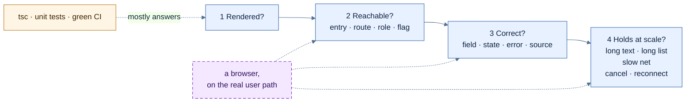
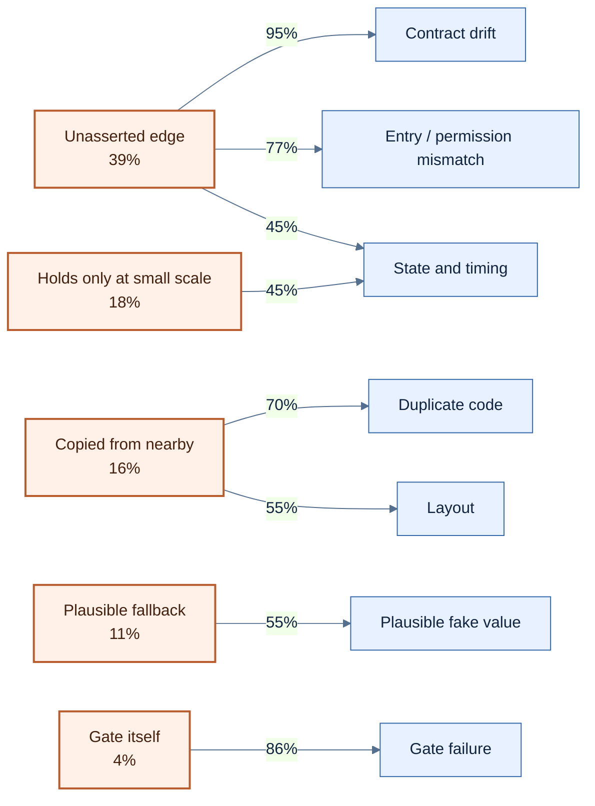
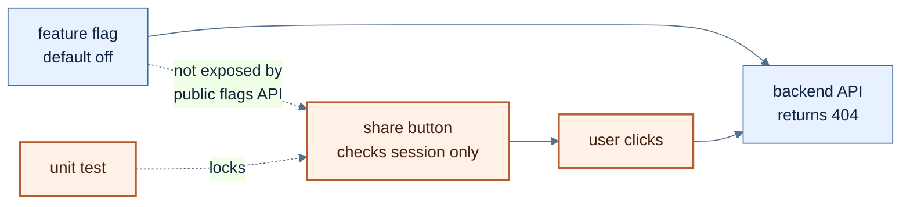
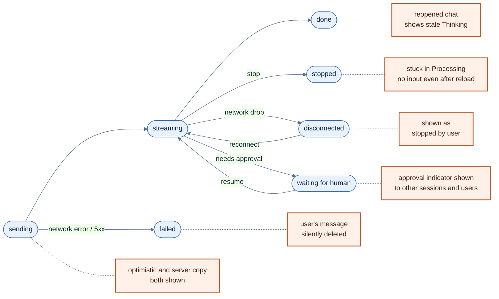
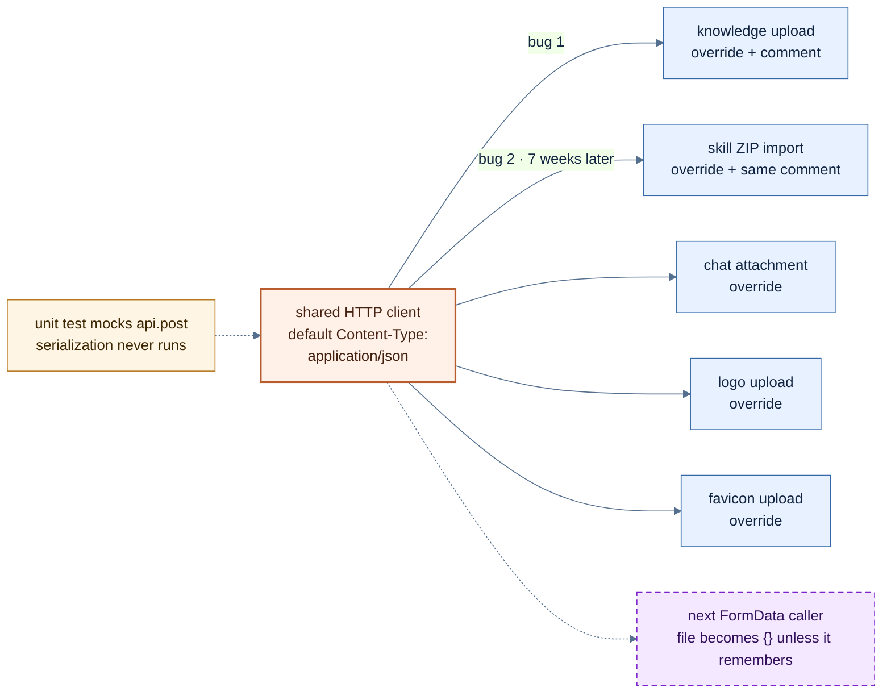
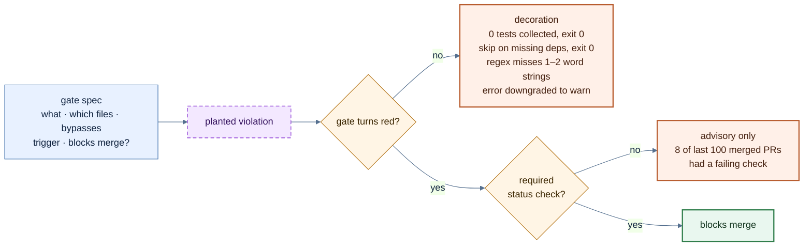

> 后端出错会给你一个500，前端出错往往给你一个看起来很正常的页面。

> *本文系AI共同创作*

# 0x00 前言

之前在[《AI编程实践总结》](https://fz.cool/AI-Coding-Best-Practice-With-Cursor/)和[《Vibe Coding生存指南》](https://fz.cool/vibe-coding-complete-guide/)里讨论过一些Bug分类，但针对产品界面类的没有往细里展开。这篇算是补上。 Vibe Coding在后端代码的实现和前端对比下来是有着非常大的差异的。也可能因为我本身就不擅长现代的前端框架类编程。

以下所有例子都来自内部项目。前端现在差不多十万行（不算测试），几个人加上一堆Agent（Claude Code、Codex、Cursor都有）一起写出来的。前端相关的提交八百多个，fix开头的三百八十多个，比feat还多。

这次我让Agent帮着把前端的fix/test/refactor提交、跟前端有关的issue、还有审计里的前端条目过了一遍，逐条归类，关键的案例我再回到提交和代码里核对。去重之后一共梳理出454个独立问题。

每个问题按两个维度归类：它表现成什么样，以及从vibe coding的角度看它为什么会出现。

> ⚠️注意
> - 选取靠的是标题前缀和关键词。feat提交里顺手修的bug、标题里没带前端字眼的issue都会漏掉，所以454其实是下限。
> - 很多修复提交只有一行标题，大约三成问题判断不出成因，一半判断不出是怎么被发现的。下面的比例都以“能判断的”为分母。
> - 成因是按提交和issue的文字判断的，没有逐个复现。单条可能判错，看的是分布。

前端的bug有一个特点：**很少报错**。后端错了，一般会有一个500、一段stack trace或者一个非零的退出码；**前端错了，更常见的情况是画出一个看起来很合理的东西。**

所以现在做前端验收时，一般需要先来个闪电四连鞭：

1. 渲染出来了吗？
2. 用户点得到吗？（入口、路由、权限、开关）
3. 显示的东西对吗？（字段、状态、错误、来源）
4. 量大了以后还扛得住吗？（长消息、长列表、慢网络、取消、重连）

因为TypeScript通过、单测全绿、CI变绿，基本只能回答第一个问题。而后面三个，是Coding Agent在终端里是搞不定的。



*图 1：验收前端的四个问题。类型检查、单测和CI大多只回答第一个，后三个要在浏览器里沿着用户的路径走一遍。*

# 0x01 先看数字，问题出在哪里？

> 能判断成因的问题里，84%出在四个地方。

按表现分：


| 表现                           | 数量  | 占比  |
| ---------------------------- | --- | --- |
| 状态与时序：切会话串台、卡在处理中、消息重复       | 94  | 21% |
| 看起来合理的假值：失败画成0、假状态、静默截断      | 75  | 17% |
| 布局与视觉                        | 61  | 13% |
| 入口和权限不一致：开关关着入口亮着、菜单藏了URL还能进 | 44  | 10% |
| 前后端契约漂移：字段名、响应形状、缺字段         | 43  | 9%  |
| 重复与死代码                       | 28  | 6%  |
| 规模与性能                        | 23  | 5%  |
| 共享请求层                        | 18  | 4%  |
| 国际化                          | 15  | 3%  |
| 门和测试本身失效                     | 14  | 3%  |
| 可访问性                         | 7   | 2%  |
| 其他（含依赖漏洞）                    | 32  | 7%  |


按成因分（能判断的321个）：


| 成因                 | 数量  | 占比  |
| ------------------ | --- | --- |
| 两边各自没错，中间那条边没人断言   | 126 | 39% |
| 只在短Demo、小数据、单会话下成立 | 58  | 18% |
| 就近照抄，没继承共享结构       | 50  | 16% |
| 用一个合理的值兜底，不肯说“不知道” | 34  | 11% |
| 门没执行、能绕过，或者本身会假绿   | 14  | 4%  |
| 规则写了没被遵守，或者被机械地遵守  | 13  | 4%  |
| 部署环境、浏览器、第三方的差异    | 13  | 4%  |
| 需求本身来回改            | 9   | 3%  |
| 测试盲区               | 4   | 1%  |


前四类加起来84%。它们有个共同点：**单看出问题的那段代码，往往挑不出错，问题出在段与段之间，或者Demo和真实使用之间。**

而且表现和成因基本是成对出现的：

- 假值里，55%是“合理兜底”；
- 入口不一致里77%、契约漂移里95%，是“边没人断言”；
- 重复代码里70%、布局问题里55%，是“就近照抄”；
- 门失效里86%，就是门自己的问题；
- 状态问题比较特殊，“边没人断言”和“只在小规模下成立”各29个。




*图 2：成因和表现基本成对出现。左边是成因占全部可判断问题的比例；线上的数字是在右边这类表现里，这个成因占多少（分母是这类表现中能判断成因的）。*

再看是怎么发现的（能判断的216个）：

- 人实际用的时候发现的：35%
- 审计出来的：31%
- PR review时：15%
- issue报告（//看不出渠道）：11%
- CI和测试：7%

CI那16个里，至少10个来自QA Agent在集成环境里跑的浏览器巡检，不是单测。单测、类型检查、lint自己抓到的前端缺陷，**个位数**！！

问题是怎么暴露出来的，很能说明它们的隐蔽性：

**布局问题最容易被人眼直接抓住，在review或日常使用时很快就会被发现；但像假值、状态时序和契约漂移，表面上不崩、不报红，测试和人眼都极难主动察觉，大部分都潜伏得很深，只有在多轮深度审计或极端链路巡检下才被一条条挖出来。假值和门，是不会自己跳出来的。**

<!-- //（按月份看，7、8两个月的问题占了六成，那段时间正好是两轮审计加上功能高峰，不能直接拿来说质量变差了。） -->

# 0x02 看起来合理的值

> 页面空白至少会让人起疑，一个看起来合理的假值不会。

页面真要是白屏了，谁都知道是出了bug；但如果它画出一个看着挺合理的值，往往没人会起疑。这一类在我过去的修复里整整有75次，细看下来大致有三种情况。

**第一种，失败被画成一个值。**

- 三个仪表盘模块在查询出错时用`?? 0`兜底，页面上显示“0条记忆”，用户分不清是真的没有，还是没读出来。同一批还有四个复制按钮：浏览器拒绝了剪贴板权限，照样提示“已复制”。这批是我和Claude一起修的。九天以后，另外七个仪表盘模块出了一模一样的问题，管理员看到的所有指标全是0，这次是同事修的。到现在前端源码里`?? 0`还有92处，不全是bug，只是没人一处处看过。
- Agent编辑页有一个工具选择器，会把“所属MCP server已停用”的工具单独分组。问题是server列表还在加载的时候，空数组`[]`也被当成了“server已停用”的证据，于是正常的工具全被标成了孤儿。同事和Cursor在两天里修了四次：第一次处理“列表还没加载完”，第二次发现重新拉取的过程中状态会报成功，第三次发现`paused`状态也得算没加载完，第四次在分组逻辑那一层又补了一道。每次修掉一个状态，下一个状态接着冒出来。
- 模型选择器是空白的，展开之后只有一个前端写死的“Gemini Flash (Fallback)”。后端日志里模型列表接口记了64次请求，全是200，没有一个报错。用户看到这个，会以为自己没配模型，或者系统已经悄悄回退到了Gemini。
- 某个详情页的接口返回404时，页面回落到一份静态fixture，显示“已批准”“已验证”。还有一个扫描结果卡片，报告因为权限被扣下了，界面上写的却是“没有已验证的发现”，用户就理解成了“没有报告”。

**第二种，演示用的东西没撤下来。**

- 设置里的License页，组织名和套餐是写死的示例数据，后端根本没有这个接口，工单却被标成了完成。
- 一个接近三千行的页面，大部分是fixture，里面用`setInterval`跑着假动画。这是一次Agent补审翻出来的，后来才改成了拿不到真实数据就直说，不再显示模拟数据。
- 最离谱的一个是我自己留下的。早期和Cursor一起做手势交互原型，HUD上会依次打出“正在校准传感器”“检测到手”“识别手势：左滑”，光标位置是随机数，摄像头从头到尾都没被申请过。它就这么在主干上待了三个月。后来删掉它的那次提交里写了一句话，我很认同：**伪造的感知和伪造的发现是同一类缺陷。对一个安全产品来说，这比任何性能问题都严重。**
- 还有一个调试用的`window.onerror`，一旦有未捕获的错误，就把整个页面换成红底的“Application Error”加堆栈。客户第一次部署的时候，字体加载的竞态这种无害的错误也触发了它。这段是我最早的提交里就带着的，后来和Cursor一起删掉了。

**第三种，失败被吞掉了，或者被截掉了。**

- 早期审计列出过十几处接口调用，失败时只打一行`console.error`，界面上什么都不显示，用户以为操作成功了。比如删除Agent时：**失败了还会无条件关掉确认框，用户就误以为已经删成功了。**
- 最严重的一个是在核心发送路径上：发消息的时候遇到网络抖动或者5xx，用户刚输入的那条消息会被直接从界面上删掉，只在console里留一行日志。
- 聊天卡片只渲染报告的前4000个字符，一份长一点的渗透测试报告直接在中间被切断，用户没有任何办法看到后半部分。还有证据展示组件，超过180个字符的字段被机械截断成三个点，既没有展开，也没有复制全文的入口。在安全审计场景下，一个被腰斩的JWT签名、一段只剩半截的PoC，不是“文字排版难看”，而是直接误导分析师把漏洞当成良性。同事后来改成了按需加载全文，加载失败就明确报错，不再悄悄退回截断版。

还有一种更隐蔽的：两个字段回答同一个问题。消息对象上同时有`agentId`和`sender`，都在回答“这条消息是谁说的”，没有任何地方规定它们必须一致，于是几个页面各写了一份兜底：

```text
// 会话页
senderKind = sender?.kind ?? (agentId ? 'agent' : 'user')

// 分享页
senderKind = sender?.kind ?? 'agent'
```

**哪天来一条两个字段都没有的消息，会话页会说是用户说的，分享页会说是AI说的，两边都不报错。** 现在没出事，只是因为后端恰好总会把`sender`填上。前两处出自同一个同事，隔了一个月；第三处换了个人写，写法跟会话页一样。每个人写的那一行单看都没错，只是没有哪段代码要对“这两个字段必须指向同一个人”负责。

这一类的成因，一大半是“合理兜底”。Agent被要求让页面能跑、好看、不报错，最省事的办法就是给一个像样的默认值。从“别让页面崩”这个目标出发，`?? 0`是一个很自然的答案。

此类问题的解法：

- 读取失败就显示“未知”或者错误态，不要给默认值。review时看到`?? 0`、`|| []`、`?? 'agent'`、`catch`里只有`console.error`这种写法，先问一句：取不到值的时候，用户看到的是事实还是编的？
- “还在加载”“加载失败”“确实为空”是三种状态，别用一个空数组表示。
- 一个展示语义只留一个权威字段。选定一个，迁移所有展示位，然后把另一个删掉。再写一个更聪明的fallback解决不了问题。
- 截断、过滤、分页，一定要让用户知道。
- fixture和模拟数据要有明显的标记，上线前用脚本扫一遍。演示代码不会自己消失。


# 0x03 前后端两边都对，中间呢？

> 按钮亮着，后端不一定答应。

这就是第二个问题：用户到底能不能点得到？

很多时候代码各写各的，单看都没错，但用户顺着真实路径一点就完蛋：按钮在界面上亮着，后端接口其实是关掉的；或者反过来，本该对普通角色隐藏的入口，前端只是把菜单项藏了，直接敲URL照样能进。

占比最高的成因就是这个：前端做了一半，后端做了一半，各自都能通过自己的测试，连起来就不对。入口不一致和契约漂移这两类加起来87个，几乎全栽在这里。

比如会话页右上角曾有一个分享按钮，可以把一段对话变成一个免登录的只读公开链接。风险很明显，所以后端给它做了一个部署级开关，默认关闭，关着的时候整组分享接口直接返回404。

前端这边，按钮的显示条件只有两个：有会话，有请求授权。这两个值都跟分享开没开没关系，整个前端没有一个地方读过这个开关。开关关着，按钮照样亮着，用户点进去才报错。

有意思的是，前端其实知道这件事。分享对话框里写好了被拒绝时的提示：“分享功能未启用。请联系管理员开启。”后端默认关闭的开关、前端不看开关的按钮、还有这句提示，是同一个提交里一起写出来的，提交信息里带着一行`Co-Authored-By: Claude`。写这段代码的Agent前后端都看得见，开关和拒绝都实现了，就是没把这两头连起来。

再往下看，缺得更彻底：前端读运行时开关的公共接口根本不返回这个开关，组件就算想读也读不到。测试里倒是有一条用例在保护这个按钮，断言的正是那个不看开关的条件。**测试本身没写错，只是把一个错误的判断锁成了回归基线。**



*图 3：开关、后端、按钮都各自没错，缺的是从开关到按钮的那条线。*

同类的还有不少：

- 侧边栏按角色隐藏菜单，但只是外观。非管理员直接敲URL就能进用户管理、系统设置和审计日志，后端返回403，页面上什么提示都没有。
- 后端返回`createdBy`，前端读的是`created_by`。非管理员永远看不到自己创建的Agent上的编辑和删除按钮。类型检查过了，因为前端的类型定义也写的是`created_by`。
- 后端的委派配置接口已经上线，前端零改动，没有任何地方调用它们。新部署一跑起来就报“名单为空”，却找不到配置入口。
- 反过来的也有：管理后台上有一个能力卡的配置，点得动，存得上，但运行时没有任何代码读它。这种死开关出现过两次。
- 知识库检索相关的三个工具，在所有的选择器里都被隐藏了，也没有种子数据，任何Agent都用不上。同一天分了两次才修完。

契约这边更直接：

- QA Agent在集成环境里跑浏览器巡检，一个页面调了8个接口，全部返回200，页面照样崩在`n.map is not a function`上。其中一个接口返回的形状不是数组。
- 一个Playbook节点缺了`position`字段，React Flow直接崩溃，整个Playbook页面对所有用户都不可用。一条坏数据拖垮一整页。
- 后端每空闲15秒发一个不带id的心跳帧，前端的解析器遇到没有id的帧就抛错，于是大约每16秒重连一次，游标一直卡在同一个位置。
- 团队设置页用一份被运行时上限截断的成员名单初始化表单。数据库里12个成员，当前环境上限是4，表单里只有4个，点一次保存，另外8个就被永久删掉了。这是PR review时被抓出来的典型案例。

此类问题的解法：

- “功能关掉时是什么样子”要写成一条前后端都得遵守的规则，并且有一个测试同时管住三层：入口看不见，直接敲URL进不去，后端照样拒绝。只测一层，Agent就能拿到一个局部为真的“完成”。
- 前端的测试数据用真实的接口形状，最好直接从后端的schema生成。手写的mock会跟着前端的想象走。
- 后端每上线一个面向用户的接口，要问一句：前端哪里调它？管理后台每加一个开关，要问一句：运行时哪里读它？
- 一条坏数据只能坏一个节点、一张卡片，别坏一整页。

```ts
// 示例：seed和断言换成项目里的真实实现
test('disabled feature is not reachable', async ({ page, request }) => {
  await seedFlags({ dangerousFeature: false })
  await page.goto('/home')
  await expect(page.getByRole('button', { name: /share/i })).toHaveCount(0)

  await page.goto('/dangerous-feature')
  await expect(page.getByTestId('feature-unavailable')).toBeVisible()

  const res = await request.get('/api/dangerous-feature')
  expect([403, 404]).toContain(res.status())
})
```


# 0x04 状态：单会话、不断网的时候都是对的

> 切一下会话，刷新一下页面，断一下网，问题就出来了。

这类问题特别搞人：静态看代码怎么都挑不出错，但只要真正跑起来，时间一长、分支一多，或者稍微有点网络抖动，状态就全乱了。

状态与时序是数量最多的一类，整整94个。之前我在《AI编程实践总结》里提过一个：点了别的对话之后，所有对话都跟着显示waiting。这类bug在这个项目里一直在换着花样重复出现：

- 登出、会话过期、切换身份以后，共享的查询缓存没清，上一个身份的数据可能还留在页面上。
- 乐观更新插入的消息和服务端返回的正式消息各显示一条，同一句话出现两遍。
- 客户端断连在界面上被显示成“用户主动停止生成”，跟后端持久化的终态对不上。
- mutation自动重试，可能把一个不幂等的POST重放一遍。
- 一个组件的注释写着“父组件会用key重新挂载”，实际上父组件没传key，旧状态一直残留。注释说实现了、代码里没有，这种情况出现过两次。

最典型的是会话列表上那个“正在执行”的指示器。同事在六天里提了五个修复PR：先是换了个转圈的样式；然后发现指示器没绑定到发起执行的人，别的会话、别的用户也会显示；接着HITL等待人工确认的指示器也有同样的问题；然后拆开了状态轮询；再然后发现初始化合并时，已经结束的指示器会被覆盖回去，显式的`null`和字段缺失被当成了一回事。五个PR之后，还有一个修“重新打开已完成的会话时显示陈旧的思考中”。每一个都是真bug，每一次都只修了眼前那一个状态。

还有更顽固的一类：

- 点了停止之后，会话一直卡在“处理中”，整页刷新也没法再输入。
- 消息同时存在两份状态，一份在查询缓存里，一份在按会话分的Map里，靠六处以上的ref补丁维持一致。负责它的hook一度膨胀到了三千多行。

这一类的成因，“边没人断言”和“只在小规模下成立”一半一半。Agent写状态逻辑的时候，脑子里通常是一条直线：发消息，等回复，显示。切会话、断网、停止、重连、换身份、两个标签页，这些都是从直线上岔出去的路，单会话的Demo里一条都走不到。



*图 4：从“发消息、等回复”这条直线上岔出去的路，每一条都出过bug。*

此类问题的解法：

- 一份数据只有一个来源。消息既在缓存里又在Map里，就一定会有对不上的时候。
- 把状态迁移画出来：发送、流式、停止、失败、断连、HITL等待、恢复、重连，每一个状态能去哪里，每一种终态在界面上显示什么。然后按这张图写测试，别只测一条直线。
- stop、cancel、resume和重连，要在浏览器里走一遍完整的来回，只看状态对象里的值是不够的。
- 同一个组件一周修了三次以上，就停下来，换个人从状态模型重新看一遍，别再修第四次。


# 0x05 每次都修在调用点（就近照抄）

> AI喜欢就近照抄，这样导致： 注释在传播，修复没有下沉。

“就近照抄”占能判断成因的16%。Agent写新代码时，会拿手边最像的那段当参照，外观对上了，结构没继承。修bug也是一样，修在眼前的调用点，共享层不动，下一个功能换个位置再撞一次。

**共享请求层。** 共享的HTTP客户端在创建时写死了`Content-Type: application/json`。axios在这个Content-Type下会把`FormData`序列化成JSON，上传的文件就变成了一个`{}`。TypeScript一句话都不会说，类型全对，文件没了。

第一次撞上是知识库上传。同事和Claude一起修的，在调用点覆盖了请求头，旁边留了一段注释，把共享客户端的问题解释得很清楚。那次提交里还有一句话值得记住：之前的单测mock了`api.post`，正好绕过了axios的序列化，所以测试一直是绿的。（被mock掉的那一层，恰好就是出bug的那一层）

七周以后，技能包导入用同一个客户端上传ZIP，后端收到的是`{"file":{}}`。这次是同事和Cursor一起修的，修法还是在调用点补请求头，旁边那段注释的开头三行，和第一次一字不差。那段注释把共享层的问题说得很准，一路被复制，共享层那一行默认值却到现在也没改，绕开它的调用点已经有五处了。



*图 5：一个共享层的默认值，五个调用点各自绕开它。注释跟着复制，默认值一直没改，下一个上传功能还得自己记得。*

同一层还有：

- 管理后台选中的工作区ID被当成默认请求头，带进了普通的业务请求，接口返回404。出现过三次，每次修一个地方。
- 后端的集合路由带尾斜杠，前端请求不带。FastAPI返回307重定向到后端的origin，浏览器跨域重定向时丢掉了`Authorization`头，接口返回401，会话过期的处理逻辑直接把用户踢回了登录页。表现是“打开API Key页面就被登出”。
- 一个设置页用原生`fetch`手写Bearer头，绕过了共享客户端的拦截器，没有token刷新，也没有统一的错误处理。
- 一个403的错误对象被当成React子节点渲染，触发React #31，整页落进错误边界。修了一处，后来另一个页面又来了一次。

**复制出来的副本。**

- 一个归一化过滤条件的helper被复制进了14个模块，其中一个变体会丢掉空字符串，清空搜索框之后缓存里会多出一条键，具体多不多，取决于这个模块抄的是哪个版本。另外有两个错误处理模块字节级相同，测试import的恰好是没人用的那一份，被8个地方引用的那份反而没有测试覆盖。这是我和Claude清理的。
- Agent头像在8个地方各自渲染，默认头像的图片文件根本不存在。
- 8个组件各自维护一个Snackbar，操作提示没法叠加，消失的时机也不一样。
- 19个面板各自手写了“未选择”时的占位，分成两种样子。其中15份，正是布局指南里当作示例写下来的那个样子，指南把复制品写成了规范。
- 一个旧的聚合修复只在旧的渲染路径上生效，界面换了新的时间线组件以后，同一个问题又出来了。
- 不只大页面会照抄，局部的侧面板和抽屉更是重灾区。当侧边栏只有300像素宽、放不下复杂配置时，Agent最习惯的做法就是就近照抄页面顶部的标准Tabs组件（带大图标和宽边距）。三个Tab一塞，直接撑爆视口，生生逼出两头带箭头的滚动条；或者把工具列表、技能列表、工作流配置往侧面板里纵向一堆，发现太长了，随手给每个列表都套上`maxHeight: 200; overflowY: 'auto'`。单看每个区块都成立，TypeScript不报错，但用户鼠标放上去，滚轮一转就掉进局部的滚动陷阱里。Agent以为自己给出了优雅的兜底，实际上在侧面板里造出了三层“俄罗斯套娃”式的微型滚动条。

**规则写进文档，Agent读过也会忘。**

管理后台有一组“左边列表、右边详情”的页面，本来有一个共享骨架。有的页面用了它，有的手拼了一份长得差不多的结构。会话记录里还留着Agent生成其中一个面板时写的计划：

> 骨架（imports/state/effects/handlers）在 plan 内给全，大段 JSX 指令“照搬［既有管理页里那段两百行的 JSX］原样”（标识符同名零改动，**确定性高于我重打**）。

**它知道有共享结构，也没有偷懒，只是觉得照抄一段现成的代码比自己重写更不容易出错。** 单看这一次，没毛病。可每照抄一次，就多一份不会跟着共享层一起变的副本，而没有任何检查会因为它抄得太好而拒绝它。

一致性修完以后，我和Claude一起把布局规则写进了前端指南，其中一条是：管理面板不放手动刷新按钮，也不放统计文案，刷新交给查询缓存的自动失效和重取。几天后，一个Codex会话做了一次近百个文件的信息架构重构，第二天又给一个任务列表加回了刷新按钮。

**翻会话记录才发现，它读过那份指南，而且不止一次。但之后的十个小时里，会话做了五次上下文压缩，每一次的摘要里都没有这条规则；** 压缩之后它重新读的是仓库说明，那里只有一行“必须使用共享骨架”。然后它发现空闲的列表不轮询，外部新建的任务不会自己出现，就提议加一个刷新按钮，我批准了。它没判断错，当初删按钮的正是我和指南一起提交的那次改动，只删了按钮，没补别的刷新方式。Agent找到的是一个真bug，用的却是规则禁止的修法；批准它的，是参与写下那条规则的我自己。

后来按钮又被删掉了，这次补上了空闲轮询，可为了遵守“不放统计文案”，旁边一句“筛选只作用于最近100条”的提示也被一起删了。没了这句话，100条以外的记录会静默地匹配不到。又过了一天，这句提示才被单独加回来。规则被机械地遵守的时候，也可能顺手删掉一条真实的语义。

现有的几条自研lint规则抓得到禁止的写法（原生弹窗、硬编码颜色、跨模块import之类），但回答不了一个正向的问题：注册成管理页的组件，是不是都用了共享骨架？代码里其实有一种正向断言，要求某个文件必须import共享骨架，可它是按文件一个个登记的。现在共享骨架有三十多个使用者，被这种断言覆盖的只有6个。

此类问题的解法：

- 同一个根因第二次出现，就去修共享层，别再修调用点。这里就是让客户端按请求体类型决定Content-Type，`FormData`不设默认值。
- 上传这种特殊传输的路径，测试不要mock请求库，至少有一条真的走一遍序列化。
- review时看到一段“解释共享层缺陷”的注释，就把它当成一个没关的bug。
- 复制出来的第二份就该收回共享层，别等到第十四份。测试要测被真正引用的那一份。
- 让脚手架、共享hook和更细的组件把正确的结构直接带进新页面，断言挂在页面注册表上，而不是按文件登记。一条会被压缩掉的规则，不如一个删不掉的默认值。
- 真正重要的规则不要只放在“链接过去的指南”里，要么写进每次都会被重新读取的那份说明，要么干脆写成lint。

翻完这些照抄的记录，我最大的感触是：以前我们做组件库、写排版规范，预设的使用者都是人类工程师——默认大家会读文档、理解上下文、懂得就地变通。但**在AI写代码的时候，写在文档里的规矩基本撑不过几轮对话。**

你很难指望Agent在上下文被压缩了五次之后，还能记得“侧面板窄的时候别用标准Tabs”或者“别在小容器里套带`overflow: auto`的列表”。靠文档提醒Agent是没有用的。真正管用的办法，是把规矩直接做进组件的结构里：侧面板的分段控件直接封装成32像素定高、等分自适应、物理上就不支持横向滚动的硬组件；列表容器强制必须传入加载和错误状态，漏传连类型检查都过不去。

后来我们做了一次全站收敛，把这个原则贯彻到底：

- **详情页全部收敛为固定头部与单一滚动**：双栏布局里，详情子组件不再自己决定是否滚动，而是由骨架统一提供 `DetailHeader`（锁定对象标题、操作和状态Chip）与 `DetailBody`（唯一的垂直主滚动流）。全站二十多个管理模块一律切断子组件私自加外层滚动的权力，嵌套滚动条的债务直接归零。
- **用容器查询解耦嵌套挤压**：双栏管理页不再依赖容易被侧栏挤爆的全局视口媒体查询，而是换成了 `@container` 容器查询——正文容器宽度一旦低于760px，不论外层开了几个侧边栏，都自动折叠为单栏，给正文留足可读空间，辅助面板退回为抽屉（Drawer）。
- **强制使用单行滚动控件**：统一做了一个单行滚动的 `AppTabs`（48px/40px），并在门禁里禁止全站直接 import MUI 原生 Tabs。

**对Agent最有效的约束，不是在指南里写“禁止这样写”，而是让这种错误的写法在代码结构上根本表达不出来。**

# 0x06 量大了呢？

> 没人测过的性能问题，不会因为没人测就不存在。

数据量一旦上来，界面还扛不扛得住？

写完Demo在本地塞两三条数据测，通常极其丝滑；但到了真实环境，遇到几千字的长文本、成百上千条的列表或者极端视口，系统就会以极其狼狈或者悄无声息的方式退化。

规模与性能单独算只有23个，但“只在小规模下成立”作为成因占了18%，其中一半落在状态问题里。这里说几个直接跟量有关的。

聊天的流式路径有一个很典型的结构：后端每吐一个token发一个事件，前端把片段拼到累计字符串上，再把整段文本写回消息对象。消息内容一变，Markdown组件就带着整段文本重新解析一遍，包括代码高亮和链接插件。回答越长，片段越多，累计的工作量接近平方级。

```text
bad:    chunk -> parse(all_text) -> render(all_text)   # 每个片段都全量来一遍

better: frozen_prefix = parse(complete_blocks)   # 只在安全的块边界更新
        live_tail     = render(raw_tail)         # 只处理当前尾部
```

那个Markdown组件内部很能说明问题：媒体凭证用`useMemo`包了，`components`映射表也用`useMemo`包了，唯独`content`是裸传的，插件数组每次渲染都新建。优化补在了外围，最热的那条路径原封不动。

一次架构审计把它列成了P1，Issues是我自己提的，到现在还开着。后来后端改成了非流式，逐token的输入没了，这条链路暂时失去了触发条件，但前端的结构一行没动。它没有被修好，只是暂时没有输入。哪天流式输出加回来，重算会原样回来。

其他几个： 

- 一个运营页面把十几类数据聚合进一个初始化接口，单次响应约2.8MB，其中侧边栏只需要标题的会话列表带上了完整的工具调用记录。有会话在等待人工确认时，前端拿这个接口当状态轮询，10秒大约12次，后台标签页也照样在跑。
- 动态背景按视口面积生成粒子，没有上限。4K屏上691个粒子，每一帧大约23.8万次邻居检查。
- 聊天历史一次只取100个会话，超过的部分静默截断，搜索也只过滤已经加载的那些。
- 审计日志按操作者搜索，每按一个键就发一次服务端查询。
- 让Agent在聊天里画图表，统计过去7天的告警类型：十来个分类，长中文标签，数值从个位数到七万多。坐标轴裁切、重叠，基本没法读。这恰好是安全运营最常见的报表形状。
- 大模型在消息里输出了一张5列宽的安全资产审计Markdown表格。Markdown组件只做了基本的排版，外层没有包带横向滚动的隔离容器，整张宽表格直接把聊天窗口和父级Flex容器横向顶爆，右侧的固定操作区全部被挤出屏幕外。长文本在前端通常死于两极：要么被粗暴地腰斩截断丢数据，要么裸着丢进DOM把排版撑裂。
- 虚拟列表没有设置`computeItemKey`，默认按位置识别行。列表会过滤掉空的agent消息，一条消息在流式过程中由空变不空，后面所有行的位置都会移动，这些行会整行重新挂载，展开状态之类的局部状态会丢，高度也要重新测量。这个还开着。

此类问题的解法：

- 按Markdown的块边界拆开，已经定型的前缀只解析一次，只重算流动的尾部；按animation frame合并高频更新。
- 虚拟列表的key用稳定的消息ID，不用位置。
- 轮询要看页面是否可见，要有退避，要问一句：这个接口需要每次都拿全量吗？
- 任何“取前N条”都要告诉用户，或者做成分页。
- 准备一份“大”的测试数据：长消息、几千行的列表、十几个分类的图表、4K屏、慢网络。用它做回放，在浏览器的trace里看长任务和掉帧。只断言最终文本相等，测不出这类问题。


# 0x07 门禁也会漏

> 测试/门禁会红Failed还不不够，红了还要拦得住。

门和测试本身失效的有14个，没解决的6个，比例在所有类别里最高。前面说过，测试自己发现的前端缺陷不到一成；翻下来看，有些门不光没发现问题，本身就是问题：

- 性能测试的入口指向了一个不在测试目录里的文件，命令收集到0个测试，照样返回成功。里面的用例访问的还是一个早就改名的路由。同事后来改成了“收集不到测试就失败”，但性能达没达标，仍然没人证明过。
- 检查未翻译文案的lint规则，用一个正则判断“这是不是一句英文”，要求至少3个单词。`Delete`、`Save`、`Cancel`、`Model Tier`这种1到2个词的文案全部漏掉，大约150处。门是绿的，中文部署下这些英文原样显示。还开着。
- 本地的前端检查脚本在依赖缺失时打印一行skip，然后以成功退出。那张工单的标题里直接写着“消除Vibe Coding false green”。也还开着。
- 一条测试断言的是表单里的英文字面量，等于把“没翻译”锁成了回归基线。后来补翻译的时候，得连测试一起改。
- 打包配置把图表库和流程图库拉进了首屏，首屏实际要加载468.6KiB，而体积检查只量入口JS。现在按路由有了预算，但每次超了，都是在功能PR里顺手调高一点，有一个路由只剩1.8%的余量。
- 前端lint我也误判过一次“债务清零”。回到diff才发现，十几条规则从`error`降成了`warn`。后来补了一道基线单调性检查，抑制条目只准减不准增，但warning在流水线里没有上限，行内的`eslint-disable`也不进基线文件，非测试代码里还有16处。
- 门禁红了也拦不住合并。仓库的合并规则要求一个review，禁止强推，但没有把任何检查设为必过项。最近一百个合并的PR里，有8个带着失败的检查合进去了（失败的都是后端单测，但规则对前端一样）。这是我自己的仓库配置，说出来有点丢人。




*图 6：一道门要先证明它会红，再证明红了拦得住。橙色框里都是这个项目里真实出现过的情况。*

审计也一样需要验证。有一次前端审计报了18处“只能点击、不能用键盘操作”的元素，还有42个没有可访问名称的图标按钮。我和Claude去修的时候逐个核对，18处里只有7处是真的，42个图标按钮实际一个都没问题（它们都包着Tooltip）。那次提交里写的是：按审计核对，而不是直接采信审计。多报的那些如果照单全收，会凭空多出一堆多余的tab停留点，那本身就是一种回归。反过来，QA Agent在集成环境里用axe扫出来的55个没有label的开关，是实打实的。

此类问题的解法：

- 设计门的时候先说清楚它管什么，看哪些文件，有哪些绕过方式，在哪个事件上执行，红了之后会不会拦住合并。
- 每一道门都要故意放进一条违规，确认它真的会红。0个测试通过不算通过，skip不算通过。
- 预算只能在单独的PR里调，写明原因。suppression不能增加，severity不能变弱，例外要有owner和到期时间。
- 把检查设成required status check。
- 审计结果，不管是人做的还是Agent做的，修之前先核对一遍。


# 0x08 最后

翻Agent会话记录时看到过很典型的一段：Agent汇报“全部CI通过，前端1345个测试”。不到十三分钟，我在同一个会话里问：“PR已经合并。你全部完成了吗？”后面列的第一条就是：侧边栏单击之后，不会再收缩成只显示图标的样子了。（当我写这篇博客的时候，这个问题又再次出现了。在上一个PR里被优化为另一种方式，在现在的PR里正在等待修回上一轮的样子。这可能也是Vibe Coding讨厌的地方）

“完成了吗”这几个字，在有的会话里出现了几十次。能判断发现方式的问题里，人用的时候撞上的占三分之一多，测试发现的不到一成。在这条流水线上，人几乎是唯一真正打开浏览器的那个。Agent在终端里验收，问题留在浏览器里。

把前面的归因收一下：

1. **边没人断言**（39%）：前端和后端、开关和入口、字段和展示，各自都对，连起来不对。要测的是那条边，测一个跨层的旅程，不要只测一层。
2. **只在小规模下成立**（18%）：单会话、短回答、不断网、三四条Demo数据。要准备一份“大”的、“坏”的数据，在浏览器里跑。
3. **就近照抄**（16%）：外观对上了，结构没继承；修在调用点，下次换个位置复活。第二次出现就修共享层，让正确的结构成为默认值。
4. **合理兜底**（11%）：不知道的时候编一个像样的值。要让“未知”和“失败”能被看见。

门本身的问题比例不高，但它决定了前面四类问题能不能被拦下来。

所以前端交付之前，我会追问这几件事：

1. **这次证明了哪一层？** 是仅仅代码跑通渲染出来了，还是用户真的点得到、数据显示得全对、量大了也扛得住？
2. **验收是在哪里做的？** 是在终端里看单测全绿，还是在浏览器里沿着真实路径完整走了一遍？
3. **功能关掉时会怎样？** 界面入口、路由守卫、后端拦截和配置接口，四处的说法是不是一致的？有没有出现“按钮亮着点进去报404”，或者“依赖加载中直接判成已停用”？
4. **读取失败时显示的是什么？** 是老老实实显示“未知”，还是用 `?? 0`、`|| []` 悄悄编了一个假值？超过180字符的长文本有没有截断展开？一个展示语义是不是只有一个权威字段？
5. **非正常路径跑过没有？** 切会话、断网重连、用户取消、坏数据输入，有没有真测过？一条脏数据会不会把一整页拖垮？
6. **量大了排版会不会炸？** 几千字的长文本、多列宽表格有没有加横向滚动隔离？窄侧边栏里有没有被套出一层又一层的微型滚动条？
7. **这个bug是第几次出现了？** 如果是第二次，修在眼前的调用点还是下沉到了共享层？
8. **门真的能拦住人吗？** 检查是不是required status check？有没有故意塞过一条反例，确认过它在依赖缺失时不会打印一行skip就返回成功？

Agent写组件真的不难，难的是它很容易在局部输入和局部测试里显得正确。把经验写进文档，Agent会在压缩里忘掉；把经验写成门，门也会漏；审计能发现问题，发现了也不一定有人修。能做的就是把门修好，隔一段时间塞一个反例进去，看它还会不会红。

然后，自己打开浏览器点一遍。

最后的最后，我想看完这篇文章的人，一定是能够感受到Vibe Coding的痛苦的。也一定明白速度带来的副作用同样的被成倍的放大了。Vibe Coding为什么开始让人讨厌，甚至不取决于你设计的SDLC流程多么完善，Engingeering多么清晰。这是Vibe Coding的原生之痛，做demo还是做产品。其中是千差万别的。