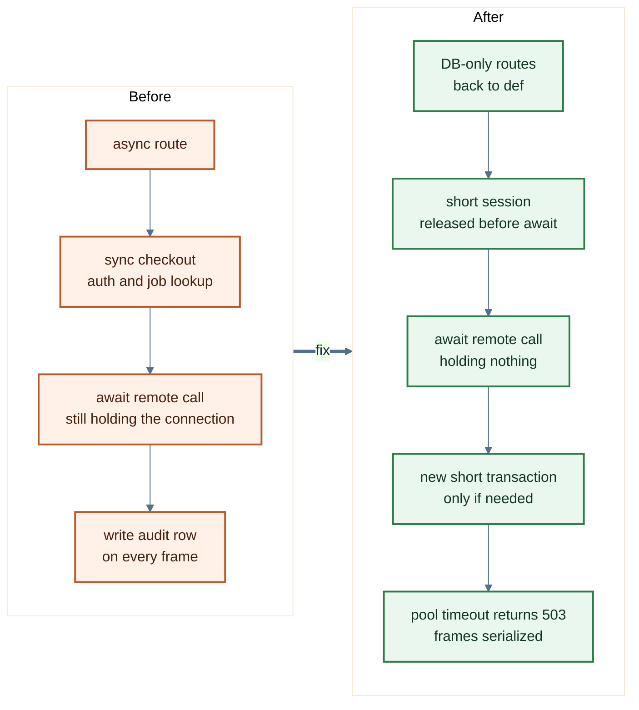
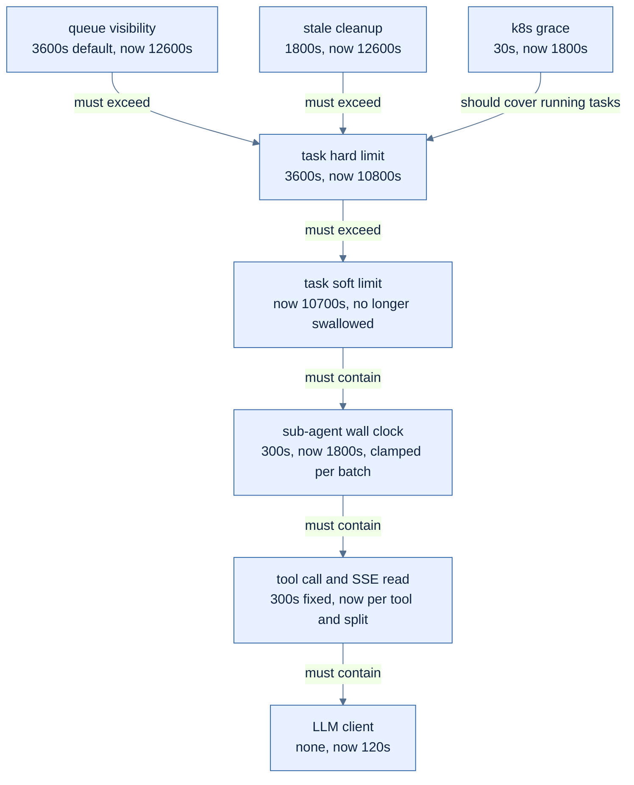
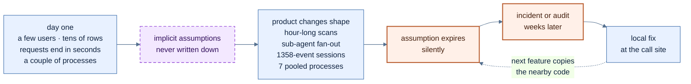

> 前端出错会画出一个看起来很正常的页面，后端变慢会给你一个一直在running的任务。

> *本文系AI共同创作*

# 0x00 前言

上一篇[《Vibe Coding的前端生死体验》](https://fz.cool/vibe-coding-issues-in-frontend/)的前言里我说过一句：Vibe Coding在后端和前端的表现差异非常大。这篇写后端，只写：**性能**。

这个项目后端是Python，FastAPI加SQLAlchemy，异步任务走Celery，跑在k8s上。十个多月下来，差不多38万行代码（不算测试和数据库迁移） 其实我们内部项目都是几人+一堆Agent一起写的。纯粹的AI Native，所有Code都是Vibe出来的，但是基于Agent的SDLC，可以参考之前写的：

* [AI Agent 时代的 SDLC：安全工程如何重新落地](https://fz.cool/agentic-sdlc-bind-to-reality/)
* [Agentic Assurance Engineering：让 AI Coding 进入真实工程](https://fz.cool/agentic-software-engineering-real-sdlc/)

这次我让Agent把后端的提交、issue和几轮实现审计翻了一遍，把跟性能有关的挑出来，关键的再回到提交和代码里核对。前半篇只写一件事：**我们做过哪些性能优化**，按类别整理，每条写清楚之前是什么样、做了什么、之后怎样。后半篇想一个问题：**为什么会有这么多需要优化的地方，为什么一开始谁都没想到。**

> ⚠️注意
> - 文中的数字有三种来源：提交说明里的本地观测、集成环境的只读观测、审计时按代码推算的。
> - 很多数字来自集成环境，不是生产容量的证明。
> - 只写了做完的。还开着的问题这篇不展开。

# 0x01 启动和发布

> 最快的一次优化只改了一行，最慢的是没人发现它慢。

**启动从5分钟到8秒。** 容器的启动命令是`uv run uvicorn`。镜像构建时依赖已经装好了，但没装项目本身，于是每次容器启动，`uv run`都会重新做一遍安装：下载pip、装项目，然后才启动服务。dev环境上观测到大约5分钟的启动开销，部署脚本的健康检查必然失败。后续直接改成执行venv里的uvicorn，再加一个`exec`，让uvicorn成为1号进程，信号也干净了。改完以后，本地用同一个镜像起一个容器大约8秒。

其他几项：

| 做了什么              | 之前                                    | 之后                       |
| ----------------- | ------------------------------------- | ------------------------ |
| worker的存活探针换成心跳文件 | `celery inspect ping`冷启动要9.44秒，探针超时10秒，worker被误杀，运行中的任务跟着中断 | 探针只读一个心跳文件              |
| worker发布先扩容、再给优雅退出时间 | 用k8s默认的30秒，每次发布都会SIGKILL跑了30秒以上的执行      | 新Pod先起来，旧worker有1800秒把手上的任务跑完 |
| 压缩只给非SSE响应        | 应用层GZip会把响应头憋到第一个数据块才发，SSE最多憋15秒，所以整个关掉了，几MB的接口一直没压缩 | 新写一个中间件，SSE原样放行，其他响应照常压缩 |

压缩这一条经历最曲折，最开始在nginx和应用层都打开了gzip（在nginx和code里来回改也折腾了很久）；之后发现应用层的GZip会把流式输出缓冲住，就把应用层的关了，只在代码里留了一段注释，然后压缩交给nginx；本月后续又写了一个只压缩非SSE响应的中间件。这样既能保证非SSE的压缩提升性能，又不会影响流式响应。

这一类常见的优化手段：

| 手段 | 怎么做 |
| --- | --- |
| 依赖和项目都在构建期装完 | 多阶段构建；先拷lock文件装依赖，吃满层缓存；运行时不联网、不安装，启动命令直接`exec`可执行文件 |
| 正确的1号进程 | 用`exec`让服务本身当PID 1，或者加`tini`这类init负责转发信号、回收僵尸进程 |
| 三种探针各管各的 | startupProbe兜慢启动；livenessProbe只回答“进程还活着吗”，不依赖数据库、Redis这些外部组件，命令要轻；readinessProbe管能不能接流量 |
| 先摘流量，再停进程 | preStop里sleep几秒，等Endpoint从Service里摘掉；应用收到SIGTERM后不再接新请求，处理完手上的再退 |
| 关停链按最短的那个算 | `terminationGracePeriodSeconds ≥ preStop + 最长任务 + 余量`；任务超时、进程管理器、应用自己的优雅退出时间都在这条链上，最短的那个才是真实窗口 |
| 长任务和发布解耦 | 任务可中断、可续跑（checkpoint），或者长任务单独一组worker、单独发布，不用每次发布都拖半小时 |
| 启动时预热 | 连接池、客户端、要编译的正则、要加载的配置，在ready之前做完，别让第一个请求买单 |
| 压缩按响应类型分开 | 流式响应（SSE）不压或者按块flush；静态资源预压缩（Brotli/gzip），能放在边缘层的尽量放在边缘层 |

# 0x02 数据库

> 一万八千行的时候，全表扫描也就几毫秒，谁都感觉不到。

数据库这一类的优化最多，也**最“标准”：加索引、去N+1、分页、合并查询。**

| 做了什么             | 之前                                       | 之后                              |
| ---------------- | ---------------------------------------- | ------------------------------- |
| 资产列表：服务端分页、搜索、复合索引 | 列表全量返回，没有服务端搜索，没有索引                      | 默认每页20条，最多200条；名称和IP的模糊搜索；按租户加类型、租户加状态的复合索引 |
| 外键补索引            | 团队可见性的子查询按`team_id`过滤，但外键不会自动建索引           | 加了索引                            |
| 审计日志补索引          | 只有主键，集成环境里被顺序扫描了三万五千多次                     | 加了（租户，时间倒序）的索引，ORM模型里也声明了       |
| 案例表补索引           | 一个定时任务每分钟逐条去重，这张表每秒被全表扫描两次多                | 加了（租户，来源引用）的索引                  |
| 密钥绑定列表去N+1       | 每一行单独查两次血缘记录，一页要发301条SQL                  | 先鉴权，再按租户每页批量IN查询一次              |
| 目标列表、扫描任务列表去N+1  | 每一行要单独发几条查询，扫描任务列表最坏301条                  | 批量查询，并加了上限                      |
| 会话摘要合并查询         | 消息数和最新预览分两次扫消息表                           | 一次带排序的窗口查询，并加了一条“只允许一次查询”的回归测试 |
| 看板的token统计       | 每次请求把所有消息正文读出来，在Python里估算                  | 写入时记录，看板只做一次SUM                 |
| 连接池按进程分配预算       | 每个进程写死20加30，所有进程加起来理论上限350个连接，滚动发布时650个，数据库上限是100 | 按进程角色分配，账面降到稳态153、滚动303；加了一条合同测试，从部署清单里重算总账 |
| 坏连接先回滚           | 长任务持有的连接断了，异常处理直接在坏Session上写失败记录，写不进去，执行永远停在running | 异常处理先回滚；子进程不再继承父进程的数据库连接 |
| 执行时长改成64位整数       | `duration_ms`是32位整数，最多表示约24.86天，一条跑了120多天的记录让清理任务每10分钟溢出一次，30天失败3593次 | 改成bigint                        |

两条值得多说一句。 资产列表是三件事一起做：分页、服务端搜索、索引。这是这个后端里最完整的一次列表优化。后来看，**它本该是一个模板，但其他列表接口还是各修各的......**

会话摘要那条改动本身很小，两条SELECT合成一条。加的那条回归测试反而更重要：它断言这个接口只能发一条消息查询，以后有人在这里多写一个查询，测试会红。**加索引、去N+1都可能被下一次改动冲掉，查询预算不会。** 连接池那条也一样。改完以后账面上仍然高于数据库的100个连接，只是缩小了，当前实际最多也就十几个。真正的变化是：以后谁加一个进程、改一个池子大小，测试都会重算一遍；

**fix不仅是改一下代码里的bug，还需要修改配套的tests，以及更新docs,changelog, 更新vibe coding context.md , Agents.md, 更新issues等等；在Agent时代其实更需要规范化，因为这些数据和规则能够更好的帮助Agent进行开发。**

类似情况：

| 手段 | 怎么做 |
| --- | --- |
| 先找慢的，再加索引 | `pg_stat_statements`按总耗时排SQL；`pg_stat_user_tables`看哪张表顺序扫描次数多；`EXPLAIN (ANALYZE, BUFFERS)`确认计划 |
| 索引跟着查询走 | 外键列要自己建索引（PostgreSQL不会自动建）；复合索引等值列在前、范围和排序列在后；只查一部分行的用部分索引，只读几列的用`INCLUDE`覆盖索引 |
| N+1在ORM层堵住 | 关联用`selectinload`/`joinedload`预加载，或者手写批量`IN`；关系默认设成`lazy="raise"`，隐式懒加载直接报错 |
| 查询预算测试 | 用SQLAlchemy的`before_cursor_execute`事件数一个请求发了几条SQL，超了就红 |
| 游标分页 | 大表别用大`OFFSET`，按（排序键，主键）做keyset分页 |
| 写时预聚合 | 看板要的统计在写入时算好，或者用物化视图定期刷；重的报表查询走只读副本 |
| 连接池总账加外部连接池 | Σ(进程数 × (pool_size + max_overflow)) × 发布倍数，常见的经验值是压在`max_connections`的七成以内，给迁移和运维留十几个；进程一多，前面加PgBouncer（事务模式，注意prepared statement和会话级设置的限制） |
| 连接健康 | `pool_pre_ping`在取连接时探一下，`pool_recycle`比服务端和代理的空闲超时短；异常路径先`rollback()` |
| 计数和时长用64位 | 时长、计数、自增ID默认`bigint`，迁移比溢出便宜 |

# 0x03 事件循环

> 单用户的时候，同步调用只会让你自己等；人一多，所有人一起等。

**FastAPI里，路由写成`def`，框架会丢到线程池里跑；写成`async def`，就直接跑在事件循环上。`async def`里面要是用了同步的数据库Session、同步的Redis、同步的文件解析，每一次调用都会把整个事件循环卡住。** 
这个后端只有一个副本、一个uvicorn进程，也就只有一个事件循环。

这一类的优化，基本都是在一个点一个点地把同步工作从事件循环上挪走：

| 做了什么              | 之前                                  | 之后                         |
| ----------------- | ----------------------------------- | -------------------------- |
| 聊天上下文组装并行、移出事件循环  | 知识库检索、历史、记忆、目标这几路在异步生成器里同步串行加载        | 两条重的分支各用独立Session，放进线程池并行跑 |
| 附件文本抽取移出事件循环      | 最大200MB的附件整个读进来，在异步处理函数里同步抽取文本，卡到探针失败 | 有上限地读取，抽取放进线程池            |
| 遏制通知移出请求路径        | 调用方要在请求里等一个外部回放完成，最多阻塞约27秒           | 结果提交以后在后台线程里做              |
| 模型凭据解析移出事件循环       | 在异步路径上同步解析模型凭据                     | 移出事件循环                     |
| 同一会话的沙箱操作串行化       | 并行子Agent在同一个事件循环上用同步`SELECT ... FOR UPDATE`抢同一行锁，第二个的锁等待卡住线程，第一个永远没法提交，worker挂死 | 按（事件循环，租户，会话）加一把`asyncio.Lock`，不同会话照常并行 |
| 只读的子Agent批次并行执行    | 委派严格串行，只读批次的总耗时等于每个子Agent之和         | 只读批次并行，有写操作的批次仍然串行         |

最典型的一次，是一个需要人接管浏览器的功能（处理验证码、MFA这类）。前端每700毫秒请求一次画面帧，88秒请求了180次。后端的路由是`async def`，先用同步Session查权限，然后带着这个数据库连接去`await`远程调用。请求一重叠，池子被这些“拿着连接在等远程”的请求占满，下一个同步取连接的请求卡住整个事件循环。后端大约99秒没有处理任何应用请求，被kubelet重启了。（这个机制是事后根据日志和代码推断的，事发时没有线程dump，具体卡在哪一步没法证实。）

后来修了五件事：只查库的路由改回`def`；权限和任务查询用短Session，远程等待之前把连接还掉，回来要写再开一个短事务；连接池加了超时，取不到就返回503；前端的帧请求改成串行；去掉了每一帧都写一条审计记录。

*图 1：那次修复的形状。不带着数据库连接去等远程，是事件循环这一类优化里最值钱的一条。*

> 要知道Vibe Coding里，写代码是要钱的，review代码是要钱的，删除代码也是要钱的。如果你制作的是Agent类平台，那么当你的Agent有性能问题的话，后台也是烧的都是$$

还有一些是并发上的：比如子Agent的行锁死锁。这个问题在SQLite上只会表现为交错，在PostgreSQL上才会真的死锁。修复的测试专门用一个临时的PostgreSQL跑了一遍。

类似的情况：

| 手段 | 怎么做 |
| --- | --- |
| 按里面的代码选`def`还是`async def` | 里面是同步IO就写`def`，让框架丢进线程池；写`async def`就整条链路异步：asyncpg或psycopg 3加SQLAlchemy的`AsyncSession`。驱动不换，光改函数签名没用 |
| 偶发的阻塞调用挪走 | `await asyncio.to_thread(...)`或`run_in_threadpool`；CPU重活用进程池或者交给worker |
| 线程池和连接池对齐 | Starlette/AnyIO默认线程池是40个，所有`def`路由和`run_in_threadpool`共用；线程比连接多，多出来的线程会拿着请求干等连接。要调就在lifespan里改`total_tokens`，和连接池一起算 |
| 不带着连接等远程 | 短事务；远程调用、LLM调用之前先提交或者归还连接，回来再开一个 |
| 让阻塞看得见 | 开asyncio的debug模式，超过`slow_callback_duration`的回调会打日志；定时测事件循环延迟，做成指标；卡住的时候用`py-spy dump`看每个线程的栈 |
| 把规则写成lint | ruff的`ASYNC`规则能抓`async`函数里的同步HTTP、`time.sleep`、阻塞文件IO；“`async`路由注入同步Session”这种项目自己的规则，用语法树写一条检查放进CI |
| 并发控制写明白 | `asyncio.Semaphore`限并行度，按资源键加锁；锁和事务相关的测试跑在和生产一样的数据库上 |

# 0x04 数据量

> 先全拿回来再说，在38条数据的时候是对的。

这一类是给“量”加上限：上传、列表、输出、扇出。

| 做了什么             | 之前                                   | 之后                          |
| ---------------- | ------------------------------------ | --------------------------- |
| 上传改成单个落盘缓冲       | 所有分块先放进列表再拼成一个bytes，按代码推算内存峰值是文件大小的2到3倍，Pod上限2Gi | 边读边算哈希，同一个缓冲文件倒回去直接交给对象存储 |
| 上传加大小上限和类型校验     | 整个文件读进内存，不校验大小                         | 知识文档50MB上限，校验MIME            |
| 会话列表游标分页         | 会话列表没有分页                              | 按更新时间的游标分页，加了置顶             |
| 工具输出分页取回         | 读回上一步工具的输出时先全量读出来再按字符切              | 有上限的分页读取，非法UTF-8的页直接拒绝      |
| 资产选择器加总量上限       | 选择器循环把资产的所有页拉完                         | 10页、2000条封顶，截断时明确提示          |
| 子Agent名册加上限       | 名册是全租户的所有Agent，回答里提到谁就派给谁               | 显式名册，最多X个，X可配置                   |

资产选择器那条有一个细节：issue里写着，集成环境一共只有38条资产，一页就拉完了，所以现在感觉不到。按每页200条算，十万条资产要发500个请求。38和十万之间的距离，就是这篇后半部分要说的东西。

类似情况：

| 手段 | 怎么做 |
| --- | --- |
| 列表接口统一分页 | 默认页大小和上限写在一个公共依赖里，所有列表接口复用，而不是各修各的；搜索和过滤在服务端做 |
| 流式处理大对象 | 上传下载按块读写，不在内存里拼完整的bytes；能让客户端拿预签名URL直传对象存储的，应用就不经手字节，大文件走分片上传 |
| 大小限制放在最外层 | ingress/nginx先挡一道（比如`client_max_body_size`），应用再按类型细分；别等应用把整个文件读完才判断太大 |
| 响应只带列表要的字段 | 列表返回摘要，详情另取；过程记录、正文这类大字段按需加载 |
| 扇出有并发度和总量上限 | 批量操作、子任务、并发外部调用都设上限；截断时明确告诉调用方截断了 |
| 大结果存引用 | 大的工具输出、报表落对象存储，返回引用，按页回读 |
| 用尾部规模的数据测 | 批量造一份P99规模的数据（十万条资产、上千个事件的会话），关键接口跑一遍，看耗时和内存 |

# 0x05 空转与放大

> 没人用的时候，系统应该是安静的。

之前做过一次性能专项，结论第一句是：集成环境里CPU、Redis、数据库、节点资源都没有饱和。问题不在容量，在应用自己。大约63分钟里，Celery完成了5622个任务，95.4%返回的是“没有活可干”。

这些空任务来自一组每5秒、10秒、15秒跑一次的定时任务。这一类后来分几次收掉:

| 做了什么              | 之前                                  | 之后                               |
| ----------------- | ----------------------------------- | -------------------------------- |
| 高频定时任务先探一下再干活     | 四个定时任务每10到30秒跑一次完整的认领事务，没活也存一个空结果     | 先用只读的EXISTS探一下，没活直接返回；集成环境每两小时少写约2400条空结果 |
| 高频定时任务不存结果        | Redis结果库7391个键里，7372个是另外6个高频定时任务写的，没人读 | 全部关掉结果存储，并加了一条测试：周期不到一分钟的定时任务必须不存结果 |
| 没有写入者的定时任务默认关闭    | 一组定时任务在所有部署里每5秒、30秒空跑，生产上根本没有写入者       | 由部署开关控制，默认关闭                     |
| 补注册两个定时任务         | 调度器每分钟投递两个任务，worker没注册，每个被丢弃59次         | 同事在一次功能提交里把它们加进了worker的注册列表 |

第二条加的那条测试，是这几次里我最满意的。它让“高频任务不存结果”从一次修复变成了一道门，以后谁加一个5秒的定时任务，忘了关结果存储，测试会红。

请求放大这边：

| 做了什么                  | 之前                                       | 之后                        |
| --------------------- | ---------------------------------------- | ------------------------- |
| 拆出轻量的会话状态接口           | 一个2.8MB的初始化接口被前端当状态轮询，10秒大约12次，其中会话列表41条就占1.81MB | 单独一个只返回状态的接口              |
| 执行开始和终态改成推送，轮询加退避     | 前端每2秒轮询一次状态                              | 执行开始、完成、失败、取消都有推送事件，轮询退到60秒 |
| 过程事件的通知里带上事件本身        | 每来一个过程事件，前端就回头把整条消息的快照重拉一遍，长会话里累计下载按审计推算约1.8GB | 通知里内联这一条事件，前端按ID更新；超过大小上限才退回整份重拉 |
| 沙箱可用性检查加缓存            | 流式输出的每一个片段都触发一次检查                         | 后端5秒的TTL缓存                |
| 外部工具不再每次先配置再调用        | 每次调用先发一次配置请求，一次调用两跳，延迟翻倍                   | 配置随请求头透传，一跳完成             |

那个2.8MB的初始化接口，源头是我自己。一月份我把运营页面要的四类数据合成了一个接口，4次往返变1次，那次提交的说明只有一句标题。后来这个接口又加了两类数据，会话列表把每个会话的完整过程记录都带上了，直到9月被当成状态轮询，才被同事拆开。

类似情况：

| 手段 | 怎么做 |
| --- | --- |
| 能推就不轮询 | 有新数据时由写入方发信号：PostgreSQL的`LISTEN/NOTIFY`、Redis Stream、outbox表；定时任务只做兜底，周期可以拉长 |
| 先探再做，批量认领 | 只读`EXISTS`探一下，有活再开事务；认领用`SELECT ... FOR UPDATE SKIP LOCKED`，一次领一批，多个worker不互相等 |
| 不需要结果就不存 | 任务上`ignore_result=True`，或者全局`task_ignore_result`；要存的结果设短的`result_expires` |
| 给“空闲”设预算 | 没人用的时候每分钟多少任务、多少SQL、多少Redis命令，记一个基线，涨了告警 |
| 轮询要会退 | 指数退避加随机抖动；页面不可见时暂停（Page Visibility API）；服务端支持`ETag`，没变就返回304 |
| 发增量，不发快照 | 事件带递增序号，客户端按序号补齐，发现丢序才整份重拉 |
| 合并重复请求 | 同一资源的并发检查用短TTL缓存，或者single-flight，同一时刻只让一个请求真正去查 |
| 接口按用途拆 | 聚合接口只给首屏用一次；状态接口单独拆、要轻；高频调用的接口写下预期频率 |

# 0x06 超时与停止

> 每一个超时值，都是被一次事故调出来的。

这一类的优化最零碎，数量也最多。看一个长任务：一次渗透测试类的扫描，标准强度要跑一到两个小时。为了让它能跑完、也能被停下来，前后做了这些：

1. MCP工具调用的300秒超时从写死改成按工具配置；`httpx.ReadTimeout`转成字符串是空串，错误信息从`MCP Execution Error: `改成能看出是哪种超时。
2. SSE的读超时和请求超时拆开，单独可配。
3. Celery任务的硬限制从1小时调到3小时，软限制留100秒余量；僵尸执行的清理阈值从30分钟调到3.5小时；Redis的visibility timeout也调到3.5小时，否则超过1小时没确认的任务会被重新投递一次。
4. 子Agent的墙钟上限从300秒调到1800秒；串行批次加了一个总预算，按任务数平分，保证一批子Agent加起来不会超过父任务的硬限制。
5. 宽泛的`except Exception`会把Celery的软超时当成普通错误吞掉，任务一直跑到被硬杀。先在工具调用链上修了十来处，又在Agent runner那一层修了一次。
6. 长时间的扫描不再让Agent在前台一边等一边轮询，改成异步作业，由Celery这边单独负责轮询。

*图 2：一个长任务要穿过的超时。每一个“now”都对应一次修复；箭头上是它们之间本该成立的关系。*

另一面是给没有超时的地方加超时：

| 做了什么                | 之前                              | 之后               |
| ------------------- | ------------------------------- | ---------------- |
| LLM客户端加超时           | 代理把SSE流挂着的时候，Celery worker永久阻塞   | 总时长120秒，连接10秒    |
| LLM重试包装器加硬超时        | 重试层没有硬超时，单次调用可能无限挂起             | 加了硬超时            |
| 共享Redis客户端加socket超时 | Redis一旦半开，所有调用方和启动初始化都永久阻塞        | 连接和读各5秒，超时变成已有降级逻辑能处理的错误 |
| 外部知识构建请求单独给超时       | 冷缓存的embedding要跑约9分钟，被共享的120秒超时截断  | 这一个请求给600秒       |
| 僵尸执行的清理补盲区          | 内联请求、没有显式结束节点的工作流、父执行结束后的子运行，都会永远停在running | 各自补了清理路径         |

类似常见的优化手段：

| 手段 | 怎么做 |
| --- | --- |
| 截止时间往下传 | 入口定一个总期限，每往下一层传剩余时间，内层超时取`min(自己的上限, 剩余预算 − 余量)`；gRPC的deadline就是这个思路 |
| 超时拆开设 | 连接、读、写、等连接池分开设（`httpx.Timeout`四项都有），流式的读超时和总时长分开 |
| 有限的重试 | 次数有上限，指数退避加抖动，只重试幂等操作；重试的总时长算进预算；全局重试比例也设上限，别在下游变慢的时候用重试把它打死 |
| Celery这几项一起看 | `soft_time_limit < time_limit < visibility_timeout`；`acks_late`加`task_reject_on_worker_lost`，任务要幂等；`SoftTimeLimitExceeded`单独捕获、清理、再抛出，别被`except Exception`吞掉 |
| 长任务异步化 | 提交时返回作业ID（202），后台负责等待和轮询，结果通过回调或推送回来 |
| 协作式取消 | 长循环里定期检查取消标志和截止时间；`asyncio.timeout()`包住每段等待；取消要能传到子进程和远端工具 |
| 心跳加租约，不只看开始时间 | 执行中定期续租，租约过期才算僵尸；比“开始超过N小时就清掉”更稳，任务时长变了也不用改阈值 |
| 不等式写成测试 | 把图2里的关系写成一条测试，配置一改就重算 |

# 0x07 Agent循环与成本

> Agent的循环没有上限，就是没有上限。

这一类是AI产品特有的：后端里跑着的Agent本身也会有性能问题，而且是按轮次、按token计价的。

| 做了什么                 | 之前                                         | 之后                              |
| -------------------- | ------------------------------------------ | ------------------------------- |
| 循环检测从警告变成终止          | 工具返回合法的空结果，同一个工具被重复调用57次以上，要到第198轮才硬终止       | 连续3次警告不听就终止；空结果附一条系统提示，让模型直接给结论 |
| 历史里用工具名代替内部UUID      | 模型把内部UUID当成了自己传错的参数，一直重试                    | 历史记录里写工具名                       |
| 校验前做数字类型转换           | 模型把`"timeout": "180"`传成字符串，同样的失败重复69次以上，浪费76%的步数和79%的token | 期望数字的参数先尝试转换             |
| 上下文预算按模型窗口推出来        | 默认写死8000 token，在100万窗口的模型上只用到0.8%；裁剪还会把刚拿到的工具结果裁掉，Agent一直重复调同一个工具 | 默认取max(32000, 窗口的四分之一)，保护最近的工具结果 |
| 工具结果降级而不是丢弃          | 窗口溢出时整组工具结果直接丢掉，模型在`row_limit=100`和`200`之间来回振荡17轮 | 全文、摘要、引用三级降级，每次成功的结果都留一个可回读的引用 |
| 告警先去重再派单             | 500条暴力破解告警会触发500次分诊执行                       | 同一指纹在窗口内只派一次；Redis不可用时放行，宁可多跑也不丢告警 |
| 技能改成按需加载             | 关键词匹配到的技能，整套方法论、工具和知识文档塞进每一条消息             | 系统提示里只放一行目录，模型需要时再调`activate_skill` |
| 没有技能时不暴露加载工具         | 模型被示例误导去调一个必然失败的工具，白白浪费一轮，首个响应约7.8秒        | 有可用技能才暴露                         |
| 预分类只试一次              | 发请求前的分类调用沿用通用的重试和超时预算，供应商一降级，延迟不可控         | 只试一次，3秒                         |

这里其实还有一个问题，就是应该把Agent执行前的契约层：Schema / 结构化输出 / 这一块做好才行，否则即便是给Agent去填空，也没有办法获得一个好的结果；

第三条那次，提交里把浪费的步数和token比例算得清清楚楚，改动本身只是在校验前加一段类型转换。**问题被描述清楚以后，Agent修性能问题并不比人差。** 这一点后面还会用到。

类似情况：

| 手段 | 怎么做 |
| --- | --- |
| 多个维度的硬上限 | 最大轮次、工具调用次数、token、墙钟，哪个先到都收尾；收尾时让模型基于已有信息给结论，而不是直接杀掉 |
| 循环检测 | 工具名加规范化后的参数做哈希，同样的调用重复N次、或者连续失败N次，判定为循环 |
| Prompt caching | 不变的放前面（系统提示、工具定义、技能目录），每轮变的放后面（工具结果、时间戳），别让动态内容打断缓存前缀。一篇2026年的评测在长程Agent任务上测到API成本降了41%到80%，首token时间快了13%到31% |
| 上下文按窗口算，分级压缩 | 预算按模型窗口的比例推；旧轮次摘要化；工具结果按全文、摘要、引用逐级降，留可回读的引用 |
| 模型路由 | 分类、路由、摘要、去重这类小活交给小模型，复杂推理才上大模型；路由本身要便宜、有严格超时 |
| 工具参数容错 | 能安全转换的类型先转；校验失败时返回能照着改的错误（期望什么、收到什么），而不是一个“invalid” |
| 工具按需暴露 | 工具列表本身占token，还会诱导模型调错；按阶段、权限、可用性只暴露需要的 |
| 去重和批处理 | 同源事件按指纹去重；不赶时间的离线任务走供应商的Batch API，价格一般是半价 |
| 按执行记账 | 每次执行记token、轮次、工具调用分布，按P99告警，而不是等月底账单 |

# 0x08 CPU与资源回收

最后是零散的几条：

| 做了什么                       | 之前                                         | 之后                    |
| -------------------------- | ------------------------------------------ | --------------------- |
| 脱敏正则重写                     | 嵌套量词在HTML类的工具输出上灾难性回溯，worker的CPU 100%卡了几十分钟，执行停在running | 改成互斥、有长度上限的分支，线性匹配；输入也加了上限 |
| S3读取用`asyncio.run()`       | 手写的新建事件循环加关闭，跳过了异步生成器的清理，连接池泄漏             | 用标准写法                 |
| 向量库客户端复用                   | 技能匹配每次调用都新建一个客户端                           | 复用                    |
| AI客户端、数据库Session用完关闭       | 后台分类器每次新建的客户端不关；动态记忆刷新的Session不关              | 用完关闭；后台任务的AI客户端加了缓存  |

常见类似问题：

| 手段 | 怎么做 |
| --- | --- |
| 正则写成线性的 | 避开嵌套量词和互相重叠的分支；Python 3.11起`re`支持原子组`(?>...)`和占有量词`*+`；不可信输入用不回溯的引擎（比如`google-re2`）；CI里用静态工具查ReDoS |
| 输入长度封顶 | 正则、解析、脱敏这类按输入长度付代价的处理，入口先截断 |
| 客户端进程级复用 | HTTP客户端、SDK客户端、向量库客户端跟着应用的lifespan创建和关闭，全进程共享，连接和TLS握手都能复用 |
| 资源用上下文管理器 | Session、客户端、文件句柄一律`with`/`async with`；测试里把`ResourceWarning`当错误，没关的资源当场暴露 |
| 别手写事件循环 | 同步代码里调异步用`asyncio.run()`；常驻的worker进程里维持一个长期的循环，而不是每次新建 |
| worker定期换血 | Celery的`worker_max_tasks_per_child`、`worker_max_memory_per_child`，子进程跑够次数或者内存涨到上限就换一个，泄漏有界 |
| 生产上能用的采样剖析 | `py-spy`不改代码就能attach正在跑的进程：`dump`看每个线程卡在哪，`record`出火焰图；想常开就上Pyroscope这类持续剖析 |

# 0x09 总结

## 为什么会有这么多需要优化的地方？

> 绝大部分优化，都是出了事以后才做的。

上面这些放在一起，后端前后大概有一百个性能问题被修掉，另外还有四十来条是没出事之前主动做的。主动的那部分，在所有性能相关的记录里只占16%；一千六百多个后端提交里，`perf:`开头的只有6个。

为什么会有这么多？我想了想，大概是这几个原因。

**第一，Agent验收的世界是P50。**

Agent写完代码，跑测试、起服务、点一下，看到的是几条数据、一两轮对话、十几秒跑完。真实的分布是这样的：

| 维度              | P50    | 尾部                |
| --------------- | ------ | ----------------- |
| 一个会话的过程事件数      | 6      | 最大1k+            |
| 一次Agent执行的时长     | 23秒    | P99约90多分钟，最长10几个小时 |
| 一次Agent执行的token  | 约XX  | P99约N倍          |

在P50里，什么写法都能过：整份快照重拉，6个事件的时候没感觉；循环拉全量，38条资产的时候没感觉；k8s默认30秒的优雅退出，23秒的执行也没感觉。默认的测试库是SQLite，锁的语义和生产库不一样，死锁测不出来。把这些问题按成因归一下类，能判断的里面，一半是“只在Demo规模下成立”。

**第二，性能是乘出来的，不在任何一个diff里。**

每个进程20加30的连接池，单看合理；乘以7个进程、乘以滚动发布的2倍，就超过了数据库的上限。每一层的超时单看都合理，一叠起来，外层比内层还短。一个状态接口单看几十毫秒，乘以每2秒一次、乘以在线人数，就是一份持续的负载。`async def`里用同步Session，乘以一个进程、一个事件循环，就是所有人一起等。

Agent每次看的是一个文件、一个diff。diff里每一个因子都对，乘积不在任何一个diff里，也就没有人对乘积负责。

**第三，能跑的默认值，就是没有上限。**

没有超时，库的默认值就是一直等；没写重试次数，就是一直重试；没写分页，就是全拿回来；没设循环上限，就是直到被硬杀。这些默认值是为普通Web请求设计的，毫秒级、秒级。这个产品跑的是一两个小时的扫描、两百轮的Agent循环、成批的子Agent扇出。300秒、3600秒、30秒，这些数字在Web世界里都很宽裕，在这里每一个都被撞穿过一次。

Agent挑默认值，是因为需求里没说别的。**要求是“让它能跑”，默认值正好能跑。**（这是一种很大的问题）

**第四，Agent照着最近的写法写。**

和前端里的问题一样。用语法树数一下，`async def`路由里注入同步数据库Session的，1月底70多个，现在100多个；同一时期，显式丢进线程池的调用从1处涨到41处。也就是说，一直有人在一个点一个点地修，同时新代码在照着旁边的路由，把同样的写法一个个写回来。框架的示例是`async def`，旁边的路由是`async def`，新写的自然也是。

我让Agent把这些问题按机制归了一下家族，同一种机制在别处又出现的，大约占七成。口径比较宽，不一定是谁照抄了谁，但修法基本都停在了出事的那一个点上。

**第五，没有记忆，也没有反馈。**

反馈来得太晚，而且不报错。功能写错了，测试当场就红；性能写错了，要等数据长到一定量、并发来到一定程度，几周甚至几个月以后才显形。到那个时候，写这段代码的那个会话早就不在了。能判断发现方式的问题里，审计和运行时观测发现的占了六成多，CI和测试自己发现的只有5%。 5月的启动优化的提交里另外两份Dockerfile同样的模式，留给后续PR。四个半月过去了，e2e环境用的那份，启动命令还是`uv run uvicorn`。**下一个会话不会记得这句话，它只看得见自己眼前的那份文件。** 这也是需要思考的地方，是否让Agent上生产做Deployment。

**第六，写得太快了。**

十个多月，这一个项目里38万行。每加一个功能，就多几个热路径、几个定时任务、几处轮询。 然而对于整个平台来说，最快的一个sprint里就增加了160多万行代码..... 人审查的带宽没变，而人审查的又基本是功能：能不能用、对不对。 对于人来说，从AI获得知识是非常快的，但是知识进入大脑是需要过程的。而AI在直接实现的过程中的信息量是没有转换为知识进入工程师的大脑的。。。 

## 为什么一开始没想到？

> 一开始不优化是对的，错在没把假设写下来。

说实话，最开始没人想到，有一部分是合理的。

1月的时候，后端还在很早的阶段：用的人就那么几个，数据很少，请求基本几秒内就结束。**那个时候去设计连接池总账、超时预算、尾部数据集，是过度设计。“过早优化是万恶之源”，在那个阶段是对的。**

问题出在后来。产品在变：从聊天变成跑一两个小时的扫描，从单个Agent变成成批的子Agent扇出，从几轮对话变成上千个过程事件的会话，进程也多到了七个带连接池的。**每一步变化，都让一个当初成立的假设悄悄过期了。** 但这些假设从来没被写下来，所以没人知道它们过期了。

300秒的MCP超时，在工具几十秒跑完的时候是对的，扫描要跑一小时以后就错了。8000 token的上下文预算，在小窗口模型上是对的，换成100万窗口的模型以后就错了。30秒的优雅退出，在执行十几秒的时候是对的，P99到了90多分钟以后就错了。哪一个都不是当初写错了，是后来没人回头看。

*图 3：一开始的假设没被写下来，产品变了，假设悄悄过期，几周以后变成事故或审计发现，然后修在出事的那一个点上。*

而且Vibe Coding让这件事更严重！！！

**一是需求里只有功能，没有运行时形状。** 给Agent的需求是“做一个分享功能”“接一个扫描工具”“加一个状态接口”，从来没有人写过“一个会话最多会有几千个事件”“这个工具会跑两个小时”“这个接口每2秒被调一次”。说句实话，写需求的人自己也不知道，包括我。Agent没法推断一个它的环境里还不存在的分布。我猜它对“正常大小”的直觉，来自训练数据里那些普通的Web应用，而这个产品的形状一点都不普通。

**二是Agent的“完成”里没有非功能的条款。** 前端那篇说过，Agent在终端里验收，测得到的只是“渲染出来了”。后端也一样，Agent测得到的只是“跑一次返回了”。我们给它的“完成”定义里，没有“1000个事件的时候还成立”，也没有“同时20个人的时候还成立”。它就不会去测。

**三是人从写代码的人，变成了批准的人。** 批准的时候，人看的是功能对不对。**很少有人在批准一个`async def`路由的时候，去想它和其他一百多个路由、一个事件循环的乘积。** 那个2.8MB接口的源头是我自己，一月份写的，提交说明只有一句标题。我自己也没想到。

但有一点让我挺意外的：**问题一旦被描述清楚，Agent也能修得很好。** 从写完所有代码，到发现新的问题，以及完成所有修复基本都是Agent在做。

所以我现在的看法是：**Vibe Coding的后端性能问题，大部分不是能力问题，是信息问题。** Agent缺的不是知道怎么加索引、怎么设超时，缺的是三样东西：尾部的数据长什么样，跨层的因子乘起来是多少，上一个会话留下了什么没做完的事。这三样，它在写代码的那一刻都看不到。

## 应该怎么办？

所以后端交付之前，我现在会补这几件事（也是Agent在做的事情）：

1. **把假设写下来。** 一个列表最多多少行，一个会话最多多少事件，一个任务最长跑多久，同时多少人，几个进程。写进代码注释或者测试里，过期了能被看见。
2. **给Agent尾部的数据。** 测试数据准备一份P99的，不是P50的；并发和锁相关的测试，至少有一条跑在和生产一样的数据库上。
3. **把乘积放在一处算。** 连接池、进程、副本、数据库上限，一张表；各层超时，一组不等式。让测试去算，别靠人记。
4. **第二次出现就写成门。** 查询预算测试、高频任务不存结果的测试、连接池的合同测试，修一个点的同时，把这一类的代价封顶。
5. **留给后续的，当场开issue。** 写在提交说明里的TODO，下一个会话读不到。要用issues跟进

Agent写一个接口真的不难，难的是它写的每一个接口，在它看到的那个规模下都是对的。

最后的最后，前端那篇结尾说，“然后，自己打开浏览器点一遍”。后端这篇的版本是：**去空闲的集成环境里看一眼任务统计。** 如果没人用的时候它也在忙，那有人用的时候，它只会更忙。

# 附录：其他类性能问题

现在的八类，启动和发布、数据库、事件循环、数据量、空转与放大、超时与停止、Agent循环与成本、CPU与资源回收，基本是按事故长出来的：哪里出过事，哪里就有一类。拿一般后端性能优化的清单对一下，下面这几类在文中没有成章。没成章不一定是没做，也可能是还没出过事，这里简单列一下。

**1. 缓存**

- 读多写少的数据（权限、租户配置、模型凭据、技能目录）做cache-aside，写入时主动失效，TTL只是兜底
- 进程内LRU加Redis两级，最热的放进程内
- TTL加随机抖动，别让一批键同时过期
- 热点键过期时用single-flight或者分布式锁，只让一个请求去重建；或者用概率提前过期（XFetch）在过期前就刷新，防缓存击穿
- HTTP层用`ETag`、`Cache-Control`，让浏览器和CDN也帮忙挡
- 命中率、键数量、内存占用做成指标

**2. 容量与水平扩展**

- API至少两个副本，加PodDisruptionBudget，发布和节点维护的时候不会同时没了
- 多个worker进程，一个循环卡住不至于全卡（连接池总账要跟着重算）
- API按CPU或者请求数用HPA伸缩；Celery worker按队列长度用KEDA伸缩，空闲时可以缩到0
- requests和limits按实测设。CPU limit压得太紧会被CFS节流，表现是P99变长，CPU使用率看着却不高
- 定期压测（k6、Locust）找拐点，把“能扛多少”写成一个数字

**3. 队列调度、背压与隔离**

- 按时长和优先级拆队列、拆worker，长扫描不堵短任务
- 长任务设`worker_prefetch_multiplier=1`，配合`acks_late`。默认预取是并发数的4倍，一个worker可能囤着几个长任务，别的worker在闲着
- 入口限流：按租户的令牌桶、并发配额
- 下游熔断：持续失败时快速失败，别排着队等超时
- 舱壁：不同下游用不同的连接池和并发上限，一个慢了不拖死全部
- 过载时主动拒绝（load shedding），比所有请求一起排队等死好

**4. 序列化与传输**

- 大响应先在剖析里看一眼序列化占了多少CPU；换orjson这类更快的JSON库，用Pydantic v2
- 别在大列表上重复做校验和转换，内部已经可信的数据直接序列化
- 字段投影：列表只给摘要字段
- 出站HTTP保持长连接、复用客户端（和0x08的客户端复用是一回事）
- 内部高频、大载荷的调用，再考虑二进制格式

**5. 检索与向量化**

- embedding按内容哈希缓存，增量构建只算变了的文档
- 批量调embedding接口，按供应商的限额控制并发
- 向量索引（比如HNSW）的`ef_search`、`m`按召回率和延迟一起调，越大越准也越慢，别拿默认值直接上线
- 先粗召回再rerank，rerank的候选数设上限
- 分段计时：查询embedding、检索、rerank、拼上下文，各花多久要看得见

**6. 数据生命周期**

- 增长型的表按时间分区（比如pg_partman），过期的分区直接`DETACH`或者`DROP`，不做大`DELETE`。大`DELETE`会产生大量WAL和表膨胀，autovacuum追不上
- 每张增长型的表写下保留期，冷数据归档到对象存储
- 大表单独调autovacuum的阈值
- 列表、统计、清理这些查询都带上分区键，否则分了区还是扫全部

**7. 模型调用层**

- 统一一个LLM网关，超时、重试、配额都收在这一层，业务代码不各写各的
- 按租户、按功能的TPM/RPM配额，超了就排队或者降级
- 多供应商、多模型的fallback，主供应商降级时自动切
- 流式调用分开监控首token时间（TTFT）和总时长，两个都设上限
- 供应商限流（429）按`Retry-After`退避，别和自己的重试叠在一起

**8. 测量、基线与回归**

- OpenTelemetry全链路追踪：FastAPI、SQLAlchemy、httpx、Celery、Redis都有现成的自动埋点，一个请求每一段花了多久直接能看到
- 数据库开`pg_stat_statements`，定期看总耗时前十的SQL
- 生产上随时能用的采样剖析（py-spy），或者常开的持续剖析
- 事件循环延迟、线程池占用、连接池等待时间做成指标
- 给关键接口定SLO（P95、P99），用错误预算决定什么时候先停下来修性能
- CI里的性能门：查询预算、`pytest-benchmark`、尾部规模的数据测试；再加定期压测

这几类里，如果只能先补一类，我会选最后一个。前面八章几乎每一条都是先出事、再测量、再优化，主动做的只占16%。测量变成日常以后，剩下的那些才有机会挪到出事之前。

## 参考文章

- [AI Agent 时代的 SDLC：安全工程如何重新落地](https://fz.cool/agentic-sdlc-bind-to-reality/)
- [Agentic Assurance Engineering：让 AI Coding 进入真实工程](https://fz.cool/agentic-software-engineering-real-sdlc/)
- [Celery: Optimizing](https://docs.celeryq.dev/en/stable/userguide/optimizing.html)
- [Kubernetes best practices: terminating with grace](https://cloud.google.com/blog/products/containers-kubernetes/kubernetes-best-practices-terminating-with-grace)
- [Kubernetes Grace Period: Why the Shortest Timeout Wins](https://www.kubeblogs.com/kubernetes-grace-period-is-not-your-grace-period/)
- [One blocking call freezes every request: FastAPI's def vs async def](https://dev.to/r9v/one-blocking-call-freezes-every-request-fastapis-def-vs-async-def-52lh)
- [What actually blocks your FastAPI event loop](https://a-smol-cat.fr/posts/asyncio_and_fastapi)
- [PostgreSQL Connection Pooling: PgBouncer, Supavisor & Built-In](https://mydba.dev/blog/postgres-connection-pooling)
- [Don't Break the Cache: An Evaluation of Prompt Caching for Long-Horizon Agentic Tasks](https://arxiv.org/pdf/2601.06007)
- [LLM Cost Optimization in 2026: Model Routing, Context Discipline, and Prompt Caching](https://www.monterail.com/blog/llm-cost-optimization)
- [Preventing Regular Expression Denial of Service (ReDoS)](https://www.regular-expressions.info/redos.html)
- [py-spy](https://github.com/benfred/py-spy)
- [How to Handle Cache Stampede (Thundering Herd) in Redis](https://oneuptime.com/blog/post/2026-01-21-redis-cache-stampede/view)
- [keda-celery-scaler](https://github.com/klippa-app/keda-celery-scaler)
- [Optimize generative AI applications with pgvector indexing](https://aws.amazon.com/blogs/database/optimize-generative-ai-applications-with-pgvector-indexing-a-deep-dive-into-ivfflat-and-hnsw-techniques/)
- [pg_partman](https://access.crunchydata.com/documentation/pg-partman/latest/pg_partman/)
